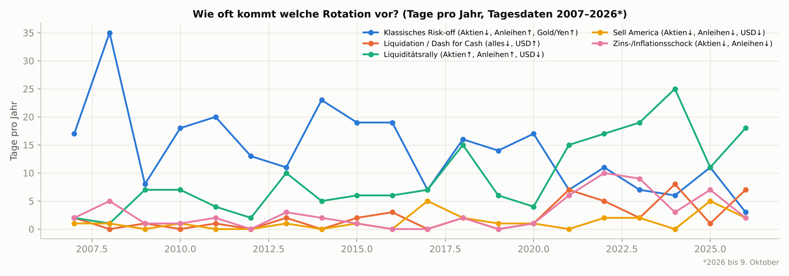
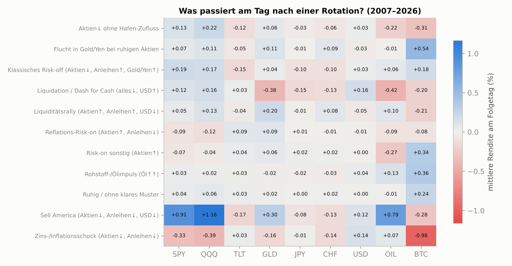
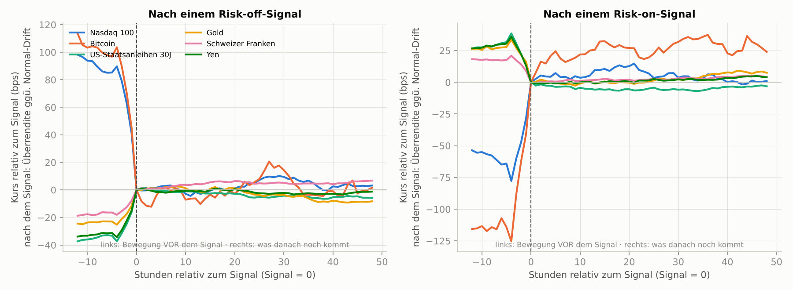
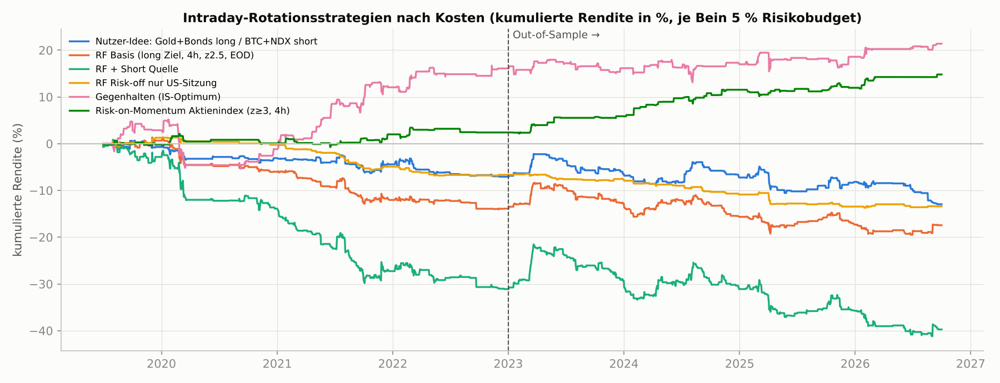
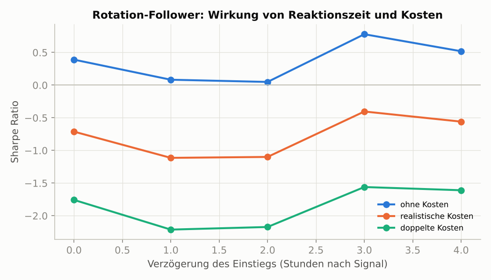
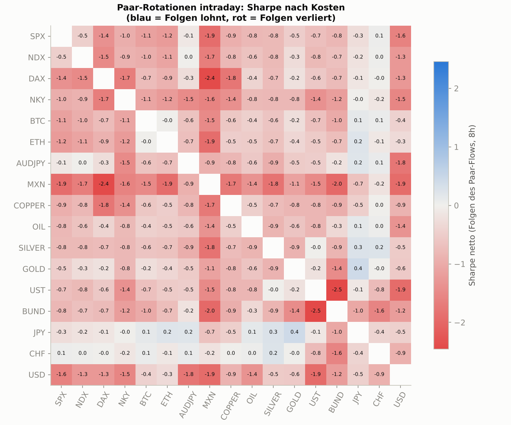

# Kapitalströme erkennen gelingt – Aufspringen lohnt sich nicht

Ja, du kannst als Retail-Trader Kapitalrotationen zwischen Anlageklassen erkennen, während sie laufen. Das geht aber fast nur über Preise, Aggressor-Volumen und Stressbarometer, denn sämtliche „echten“ Flussdaten (ETF-Zuflüsse, COT, Fondsflüsse, TIC) erscheinen Stunden bis Wochen zu spät. Das eigentliche Problem ist nicht das Sehen, sondern das Timing. In der eigenen Stunden-Simulation über 17 Märkte (Juli 2019 bis September 2026) waren beim Auslösen eines sauberen Risk-off-Signals bereits 90–100 % der Bewegung gelaufen. Danach folgten im Mittel nur 0–3 Basispunkte Fortsetzung, weniger als ein Round-Trip kostet, und binnen 24 Stunden gaben die sicheren Häfen sogar wieder nach. Folgerichtig verloren alle 900 getesteten Varianten des „Aufspringens“ im In-Sample nach Kosten, und deine Ausgangsidee (bei Risk-off Gold und T-Bonds long, Bitcoin und Nasdaq short) kam auf eine Sharpe Ratio von −0,51. Profis handeln Rotation entweder langsam als Trendfolge über Wochen (die großen Trendfolger im SG Trend Index liegen 2026 bei rund +16 %) oder in Mikrosekunden als Arbitrage. Die Stundenlücke dazwischen ist kein etabliertes Geschäftsmodell, weil Kosten und Umkehr den kleinen Rest auffressen. Tragfähig sind in den Daten drei andere Dinge: langsames Cross-Asset-Momentum auf Tagesbasis (eigene Out-of-Sample-Sharpe 0,70–0,78), das Mitlaufen bei starken Risk-on-Erleichterungsrallys in Aktienindex-Futures (Sharpe 1,02, aber erst nachträglich formuliert) und, deutlich fragiler, das Gegenhalten nach Panikschüben. Meine ehrliche Empfehlung: ein langsamer Trend-Kern in C#/LEAN mit IBKR-Futures, zwei kleine Intraday-Satelliten im Vorwärtstest und der Flow-Detektor als Auslöser für Gegenbewegungen und als Stressschalter. Als Startschuss zum Hinterherlaufen taugt er nicht.

## Der Geldstrom zeigt sich zuerst im Preis, gemeldete Flüsse kommen zu spät

Stell dir Kapitalströme wie ein Gewitter vor. Der Blitz ist die Preisbewegung, der Donner sind die Statistiken, die hinterher melden, wie viel Geld wohin geflossen ist. Für einen Intraday-Händler zählt nur der Blitz. Dein Methodenbaukasten zerfällt damit in drei Gruppen:

- **Gemeldete Flüsse:** zu langsam für Einstiege, brauchbar als Regimefilter.
- **In Echtzeit messbare Spuren des Flusses:** Preise, Orderflow und Stressindikatoren.
- **Modellierte „erzwungene“ Flüsse regelgebundener Akteure:** die einzige Kategorie, die überhaupt einen Blick nach vorn erlaubt.

### Gemeldete Flüsse sind der Donner nach dem Blitz

Die Verzögerungsleiter ist eindeutig:

- **Bitcoin-ETF-Flüsse:** Die Farside-Tabellen zu den US-Spot-Bitcoin-ETFs werden „typischerweise abends und nachts (US-Zeit)“ aktualisiert. Am ersten Tag sind sie oft unvollständig, später werden sie teils revidiert ([Farside](https://farside.co.uk/); [Newhedge](https://newhedge.io/changelog/spot-etf-flows-live-pending.md)).
- **Fondsflüsse:** Die ICI-Daten kommen wöchentlich mit rund einer Woche Verzug ([ICI](https://www.ici.org/research/stats/flows)). EPFR liefert tägliche Fondsflüsse schon am Folgetag, aber nur gegen institutionelle Lizenz ([CEIBS](https://ceibs.libguides.com/az/epfr-data)).
- **Positionsdaten:** Die CFTC-Daten (COT) bilden den Dienstag ab und erscheinen freitags um 15:30 Uhr New Yorker Zeit ([CFTC](https://www.cftc.gov/MarketReports/CommitmentsOfTraders/index.htm)).
- **Auslandskäufe:** Die TIC-Daten zu Auslandskäufen von US-Wertpapieren hinken **sechs bis acht Wochen** hinterher ([US Treasury](https://home.treasury.gov/data/treasury-international-capital-tic-system/release-dates-of-tic-data)).
- **Risiko- und Stressindizes:** Selbst die schönsten Indizes sind Tagesware. Der Risk-on/Risk-off-Index der Kansas City Fed ist die erste Hauptkomponente täglicher Veränderungen von Kreditrisiko, Aktienvolatilität, Finanzierungsbedingungen sowie Währungen und Gold und liegt als CSV vor ([KC Fed](https://www.kansascityfed.org/data-and-trends/risk-on-risk-off-index/)). Der Stressindex des OFR erscheint mit zwei Geschäftstagen Verzug ([OFR](https://www.financialresearch.gov/financial-stress-index)).
- **Kreditspreads:** Die High-Yield-Spreads auf FRED sind täglich und seit April 2026 auf ein rollierendes Dreijahresfenster beschnitten ([eco3min](https://eco3min.fr/en/credit-spreads-recession-risk-dataset/)).

Hinzu kommt, dass Flüsse dem Preis oft hinterherlaufen, statt ihn anzukündigen. Bei den Bitcoin-ETFs fand FalconX zwar einen Granger-Effekt der Vortageszuflüsse (p = 0,004). Die Flüsse erklären aber **weniger als 10 % der Kursvarianz** ([FalconX](https://www.falconx.io/newsroom/what-can-spot-etf-flows-tell-us-about-the-trajectory-of-bitcoin-prices-a-preliminary-statistical-investigation)). Das oft zitierte R² von 0,80 zwischen 30-Tage-Flüssen und 30-Tage-Rendite misst einen gleichzeitigen Zusammenhang, keine Vorhersage ([The Block](https://www.theblock.co/amp/post/359560/analyst-explains-why-etf-flows-continue-to-drive-bitcoins-price-while-treasury-companies-have-muted-impact)). Bei klassischen Fonds zeigt sich über lange Horizonte sogar das Gegenteil: Hohe Zuflüsse sagen niedrige spätere Renditen voraus, das berühmte „dumb money“ ([Frazzini & Lamont](https://nber.org/papers/w11526)). Gemeldete Flüsse gehören deshalb in die Regimeschicht, etwa als Vorab-Tendenz vor der europäischen Eröffnung oder als Bestätigung eines Trends. Als Auslöser für einen Einstieg taugen sie nie.

### In Echtzeit messbar sind Preise, Aggressoren und Angstbarometer

Live misst du die Spuren im Schnee, nicht das Tier selbst. Die robusteste Spur ist der Preis. Eine volatilitätsnormierte Rangliste der Renditen über einen festen Korb zeigt, wohin das marginale Kapital gerade fließt. In den Korb gehören Aktienindex-, Anleihen-, Gold-, Öl-, Kupfer- und Währungsfutures plus Bitcoin und Ether. Darauf lassen sich die Tagesindikatoren intraday nachbauen:

- ein laufender RORO-Faktor als erste Hauptkomponente der Renditen,
- Kritzmans Absorption Ratio als Maß dafür, wie gleichgeschaltet die Märkte sind ([State Street](https://globalmarkets.statestreet.com/research/portal/insights/article/2a8e282a-343b-443c-b362-1634c71d2d26)),
- der Turbulenzindex als Mahalanobis-Distanz, dessen Stressphasen typischerweise **Wochen** anhalten ([Alpha Architect](https://alphaarchitect.com/skulls-financial-turbulence-and-risk-management/)).

Wichtig ist der Beipackzettel: Die Literatur hat diese Konstrukte auf Tagesdaten validiert. Intraday sind sie deine eigene Konstruktion und müssen sich erst im Backtest bewähren. Genau das hat die eigene Simulation getan (siehe unten). Ihr Flow-Score teilt die Stundenrendite durch die Volatilität, die für diese Tagesstunde üblich ist, und fasst das zu einem RORO-z-Wert zusammen. Er erkennt zuverlässig **55–85 Risk-off- und 33–75 Risk-on-Schübe pro Jahr** ([eigene Berechnung: signal_frequency.csv](../results/hourly/signal_frequency.csv); [Code: flow.py](../mf_trader/flow.py)).

Die zweite Spur ist der Orderflow, also die Frage, wer gerade aggressiv kauft oder verkauft. Im Kryptomarkt ist das ein Geschenk:

- **Aggressorseite:** Jede Binance-Kerze enthält das Taker-Kaufvolumen, und der aggTrades-Strom markiert die Aggressorseite jedes Trades. Damit lässt sich ein exaktes kumuliertes Volumendelta (CVD) kostenlos berechnen, in Echtzeit und historisch ([Binance](https://developers.binance.com/docs/binance-spot-api-docs/rest-api/market-data-endpoints)).
- **Funding, Open Interest, Liquidationen:** gibt es gratis dazu. Der Liquidationsstrom schickt aber nur die letzte Liquidation pro Symbol und Sekunde und liefert damit nur eine Untergrenze ([Binance](https://developers.binance.com/docs/derivatives/usds-margined-futures/websocket-market-streams/Liquidation-Order-Streams)).
- **Futures-Taker-Statistik:** reicht nur 30 Tage zurück. Wer sie backtesten will, muss selbst mitschreiben ([Binance](https://developers.binance.com/docs/derivatives/usds-margined-futures/market-data/rest-api/Taker-BuySell-Volume)).
- **Cloud-Betrieb:** Viele Rechenzentrums-IPs bekommen von Binance einen HTTP-451-Fehler ([Apify](https://apify.com/ninhothedev/binance-futures-scraper)).

Inhaltlich ist Orderflow allerdings ein Spiegel, kein Fernglas. Die Orderflow-Imbalance erklärt kurzfristige Preisänderungen fast linear ([Cont, Kukanov & Stoikov](https://arxiv.org/abs/1011.6402)), sagt aber wenig über die Zukunft. Eine Studie von 2026 an Krypto-Perpetuals findet nur an Viertelstundengrenzen Prognosekraft für die folgenden Stunden ([arXiv 2607.09426](https://arxiv.org/abs/2607.09426)). Die eigene Messung bestätigt das deutlich: Die Binance-Taker-Imbalance korreliert mit der Bitcoin-Rendite **derselben Stunde zu 0,44, mit der nächsten Stunde zu −0,005** ([eigene Berechnung: crypto_extras.json](../results/hourly/crypto_extras.json)).

On-Chain-Zuflüsse zu Börsen hatten 2017–2023 echte Prognosekraft auf 1–6 Stunden: ETH-Zuflüsse wirkten negativ, USDT-Zuflüsse positiv ([arXiv 2411.06327](https://arxiv.org/abs/2411.06327)). In brauchbarer Auflösung sind sie aber kostenpflichtig. Am schwächsten schneiden klassische Balken-Indikatoren wie MFI, Chaikin Money Flow oder OBV ab. Ihre eigene Dokumentation warnt vor Fehlsignalen nach Kurslücken und in volatilen Phasen ([StockCharts](https://chartschool.stockcharts.com/table-of-contents/technical-indicators-and-overlays/technical-indicators/chaikin-money-flow-cmf)).

Die dritte Spur sind Angstbarometer:

- **VIX:** in Echtzeit über das Cboe-Indexabo bei IBKR ([IBKR](https://www.interactivebrokers.com/docs/general/market-data-subscriptions/popular-market-data-subscriptions/introduction)).
- **DVOL (Krypto-Volatilität):** kostenlos von Deribit ([Deribit](https://docs.deribit.com/api-reference/market-data/public-get_volatility_index_data.md)).
- **Put/Call-Quoten:** als halbstündliche Schnappschüsse bei Cboe ([Cboe](https://res.cboe.com/us/options/market_statistics)).
- **MOVE (Anleihevolatilität):** in Echtzeit nur über kostenpflichtige ICE-Feeds ([ICE](https://developer.ice.com/fixed-income-data-services/catalog/ice-data-indices-move-index)).

Vorsicht bei Indikatoren, die aus Kursquotes berechnet werden: Der VIX sprang am 5. August 2024 vor der US-Eröffnung auf fast 66. Das kam überwiegend von ausgeweiteten Optionsquotes, nicht von echten Trades ([BIS Bulletin 95](https://www.bis.org/publ/bisbull95.htm)). Ein Barometer also, das im Sturm selbst wackelt.

### Erzwungene Flüsse sind der einzige echte Blick nach vorn

Vorhersehbar sind nur die Flüsse, die jemand tun muss. Trendfolgende CTAs, volatilitätsgesteuerte Fonds, gehebelte ETFs und Pensionsfonds handeln nach Regeln, und die Banken modellieren genau das:

- **CTAs:** BofA bildet zwölf Trendfolger unterschiedlicher Geschwindigkeit nach. Im August 2026 schätzte die Bank, dass nennenswerte CTA-Aktienverkäufe erst ab mehr als 4 % Rückgang einsetzen würden ([Tickmill/BofA](https://www.tickmill.com/blog/institutional-insights-bofa-systematic-flows-monitor-11826)).
- **Vol-Control-Fonds:** Sie reagieren auf realisierte, nicht auf implizite Volatilität ([Acadian](https://www.acadian-asset.com/-/media/files/commentary-pdfs/acadian--defensive-investing-strategies-feedback-loops-and-echoes-of-1987.pdf)) und verwalten laut Nomura rund **1,3 Billionen Dollar** ([Invezz](https://invezz.com/en-ae/news/2026/04/08/volatility-funds-near-end-of-selling-spree-nomura-sees-stock-bounce/)).
- **Pensionsfonds:** Ihr Rebalancing drückt bei Aktienübergewicht die Rendite des Folgetags um **etwa 17 bp** ([Harvey, Mazzoleni & Melone](https://www.nber.org/papers/w33554)).
- **Optionshändler:** Sie sichern Short-Gamma-Positionen ab, und das treibt nachweislich die Schlussbewegung ([Baltussen et al.](https://www3.nd.edu/~zda/intramom.pdf)).

All das kannst du aus Preisdaten näherungsweise selbst rechnen: CTA-Trigger aus 20/60/125/250-Tage-Signalen, Vol-Control-Druck aus realisierter Volatilität, Monatsend-Rebalancing aus dem Renditeabstand zwischen Aktien und Anleihen. Die veröffentlichten Bankschätzungen erreichen Privatanleger dagegen nur aus zweiter Hand und widersprechen sich. Für denselben Zeitraum kursierten Goldman-Zahlen von 33, 40 und über 100 Milliarden Dollar CTA-Verkäufen ([MEXC](https://www.mexc.com/news/666746); [The Wealth Advisor](https://www.thewealthadvisor.com/article/goldman-says-momentum-traders-sell-stocks-every-scenario)).

| Methode / Datenquelle | Was sie misst | Verzögerung | Zugang & Kosten für dich | Nutzen intraday | Nutzen als Regimefilter |
|---|---|---|---|---|---|
| Volatilitätsnormierte Cross-Asset-Renditen, RORO-Faktor, Absorption Ratio, Turbulenz | wohin Kapital gerade fließt, wie gleichgeschaltet die Märkte sind | Echtzeit | IBKR: CME/CBOT/COMEX-L1 je 1,55 USD/Monat, Eurex-L1 frei ([IBKR](https://www.interactivebrokers.com/en/pricing/market-data-pricing.php)) | **hoch – Kern der Erkennung** | hoch |
| Krypto-Taker-Volumen, CVD, Funding, Open Interest, Liquidationen | Aggressoren, Hebelaufbau | Sekunden | Binance/Deribit frei; CoinGlass-API ab 29 USD/Monat ([CoinGlass](https://coinglass.com/pricing)) | mittel (nur gleichzeitig, als Bestätigung) | mittel |
| Futures-Orderflow aus Tickdaten | Aggressoren | Echtzeit | IBKR-Schnappschüsse alle 250 ms; ob CME-Trades mit Aggressorseite kommen, ist ungeprüft | gering bis mittel | gering |
| VIX, DVOL, Kredit-ETF-Verhältnisse (z. B. HYG/IEF) | Stress | Echtzeit | IBKR-Cboe-Abo; Deribit frei | mittel (Stressschalter) | hoch |
| MOVE, Dealer-Gamma (GEX) in Echtzeit | Zinsvolatilität, Gamma-Regime | Echtzeit | nur kostenpflichtig | gering | mittel |
| CTA-, Vol-Control-, Rebalancing-Modelle | erzwungene künftige Flüsse | vorab berechenbar | selbst aus Preisen; Bankstudien nur indirekt | mittel um Triggerlevels, Handelsschluss, Monatsende | hoch |
| Spot-ETF-Flüsse (BTC/ETH) | echte Zeichnungen und Rückgaben | US-Abend, revidiert | frei (Farside) | keiner für Einstiege | hoch für Krypto |
| COT, ICI, TIC, EPFR | Positionierung, Fondsflüsse | 1 Woche bis 2 Monate | frei (EPFR teuer) | keiner | mittel |
| KC-Fed-RORO, OFR-FSI, HY-Spreads | Risikoappetit, Stress | 1–2 Tage | frei | keiner | hoch |
| MFI, CMF, OBV, A/D | Kauf- und Verkaufsdruck aus OHLC-Balken | Echtzeit | frei | gering | gering |

Für IBKR als Datenquelle heißt das konkret: Die Daten sind billig, aber die API hat zwei Engpässe. Sie liefert Futures-Kurse als **Schnappschüsse alle 250 Millisekunden** ([IBKR](https://www.interactivebrokers.com/docs/tws-api/doc/market-data-live/top-of-book-l-1/market-data-update-frequency)). Und sie erlaubt höchstens **60 historische Abfragen pro zehn Minuten** ([IBKR](https://www.interactivebrokers.com/docs/tws-api/doc/market-data-historical/historical-data-limitations/pacing-violations-for-small-bars-30-secs-or-less)). Für eine Erkennung im Minuten- bis Stundentakt reicht das locker. Für mehrjährige Intraday-Backtests ist IBKR ungeeignet, weshalb die eigene Simulation auf HistData, Dukascopy und Binance zurückgriff ([README](../README.md)).

## Profis handeln Rotation in Wochen oder Mikrosekunden, die Stundenlücke blieb leer

Die kurze Antwort auf deine zweite Frage: In der von dir beschriebenen Form betreibt keine große Profi-Kategorie das als eigenständige Strategie. Gemeint ist: Rotation erkennen, für Stunden aufspringen, bei nachlassendem Momentum aussteigen. Spektakulär verworfen wurde die Idee nicht, sie wurde eher zwischen zwei Stühlen zerrieben. Auf der langsamen Seite verdienen Trendfolger an Rotationen, die sich über Wochen entfalten. Auf der schnellen Seite schöpfen Hochfrequenzhändler die kurzen Brüche im Gleichlauf zwischen Märkten in Millisekunden ab. Wer auf dem Bahnsteig steht, während die einen im Stellwerk sitzen und die anderen nach Fahrplan reisen, hat beim Einsteigen schlechte Karten. Dazwischen sitzen die Flow-Desks der Banken (JPMorgan, Goldman, BofA). Sie handeln Rotation nicht selbst, sondern rechnen ihren Kunden vor, was die regelgebundenen Akteure tun müssen ([Tickmill/JPM](https://www.tickmill.com/blog/institutional-insights-jpmorgan-flows-positioning-130125)).

### Trendfolger verdienen an Wochen, nicht an Stunden

Die professionelle Form des „Money-Flow-Tradings“ ist Managed Futures. Der SG Trend Index umfasst die zehn größten Trendfolger, darunter AQR, Man, Winton und Transtrend ([Hedgeweek](https://www.hedgeweek.com/sg-prime-services-releases-the-cta-indices-constituents-for-2026/)). Seit 2000 erzielte er im Schnitt **5,33 % pro Jahr** bei einem maximalen Drawdown von 20,61 %, 2025 nur +2,39 % ([TTU](https://www.toptradersunplugged.com/trend-following-performance-report-december-2025/)). 2026 ist ein Paradejahr mit **+16,14 % bis 11. Oktober** ([BarclayHedge](https://portal.barclayhedge.com/cgi-bin/indices/displayHfIndex.cgi?indexCat=SG-Prime-Services-Indices&indexName=SG-Trend-Index)). Verdient wurde das mit drei Positionen: short US-Anleihen vor dem Ausverkauf im September, long Dollar und long Rohöl seit Januar ([HedgeCo](https://hedgeco.net/news/?p=92151)). Das sind Rotationen, aber über Monate, nicht über Stunden.

Die Jahrhundert-Studie von AQR zeigt, warum das funktioniert. Trendfolge war in 8 der 10 schlimmsten 60/40-Drawdowns seit 1880 positiv, weil sich diese Bärenmärkte „allmählich über mehrere Monate statt abrupt über wenige Tage“ entwickelten ([Hurst, Ooi & Pedersen](https://www.TrendFollowing.com/whitepaper/Century_Evidence_Trend_Following.pdf)). In V-förmigen Schocks, also genau deinen Intraday-Ereignissen, verlieren Trendfolger dagegen. Nach dem Zollschock im April 2025 lag SG Trend bei **−9,33 % seit Jahresbeginn** ([SG CTA Update 2025](https://content.sgmarkets.com/CTA_UPDATE_KEEPING_UP_WITH_THE_TRENDFOLLOWERS_2025)), einzelne Fonds verloren über 40 % in einem Monat ([Institutional Investor](https://www.institutionalinvestor.com/index.php/article/top-managed-futures-funds-are-down-sharply-liberation-day)).

Am nächsten an deiner Idee sind kurzfristige CTAs. Der SG Short-Term Traders Index hielt sich im April 2025 mit etwa −0,9 % deutlich besser ([SG CTA Update 2025](https://content.sgmarkets.com/CTA_UPDATE_KEEPING_UP_WITH_THE_TRENDFOLLOWERS_2025)). Im starken Trendjahr 2026 liegt er aber nur bei +5,32 % ([BarclayHedge](https://portal.barclayhedge.com/cgi-bin/indices/displayHfIndex.cgi?indexCat=SG-Prime-Services-Indices&indexName=SG-Short-Term-Traders-Index)). Wie viel Maschinerie dahintersteht, zeigt Crabel (Stand 2019) ([The Hedge Fund Journal](https://thehedgefundjournal.com/crabel-contra/)):

- Das Flaggschiff hält Positionen im Schnitt etwa einen Tag.
- 99 % der Orders gehen von co-lokalisierten Servern mit rund **15 Mikrosekunden** Latenz direkt an die Börse.
- Pro Million Dollar Kapital dreht es etwa 15.000 Round-Turns im Jahr.
- Jedes Jahr werden 10–15 % der Modelle ersetzt, weil Signale verfallen.

Bezeichnend ist Crabels Produkt „Contra“. Es entstand, weil Kunden nach den abrupten Umkehrungen von 2018 eine schnellere Krisenabsicherung wollten. Sein Schutzbaustein „produziert Fehlalarme, die typischerweise moderate Verluste verursachen“ (ebd.).

Man AHL beziffert das Grundgesetz dahinter. Alle Trendgeschwindigkeiten haben brutto eine positive Sharpe Ratio. Nach Kosten ist sie für schnelle Varianten aber „langfristig deutlich niedriger“, obwohl schnelle Systeme in den schlimmsten Aktienphasen die besten Krisenrenditen liefern ([Man Group](https://www.man.com/insights/need-for-speed-trend-following)). Du zahlst pro Umschlag mehr als AHL mit seinem Kostenmodell für fünf Milliarden Dollar, also trifft dich dieses Gesetz härter.

Am anderen Ende steht die Hochfrequenz. Die Preisfindung bei US-Anleihen und US-Aktien findet überwiegend in Futures statt ([Dobrev & Schaumburg](https://benny.aeaweb.org/conference/2018/preliminary/paper/QdkHkBSZ)). Zwischen ES-Future und SPY gibt es rund 1.000 Arbitragegelegenheiten pro Tag, zusammen etwa 75 Millionen Dollar im Jahr, und sie gehen vollständig an die Schnellsten ([Budish, Cramton & Shim](https://conference.nber.org/conf_papers/f69665.pdf)). Geplante Makrodaten sind binnen **ein bis zwei Minuten** eingepreist ([Fleming & Remolona](https://www.bis.org/publ/work71.pdf)). Mit 250-Millisekunden-Schnappschüssen bist du hier vier bis fünf Größenordnungen zu langsam.

### Die Forschung kennt den Fahrplan der Panik: Der erste Tag ist fast alles

Warum die Stundenlücke so wenig hergibt, erklärt die beste Studie zu Fluchtbewegungen. Baele, Bekaert, Inghelbrecht und Wei identifizieren in 23 Ländern von 1980 bis 2015 „Flight-to-Safety“-Tage ([Baele et al. 2020](https://business.columbia.edu/sites/default/files-efs/citation_file_upload/Flights%20to%20Safety.pdf)):

- Sie machen **weniger als 2 % aller Tage** aus.
- Am ersten Tag schlagen Anleihen Aktien um durchschnittlich 2,79 %.
- **62 % der Episoden dauern nur einen Tag**, keine länger als zehn.
- An den Folgetagen schrumpft der Effekt auf −0,13 % pro Tag bei Aktien und +0,05 % bei Anleihen.
- Franken (+0,33 %) und Yen (+0,44 %) werten an solchen Tagen verlässlich auf. Gold legt im Schnitt nur 3 bp zu und wird erst nach Herausrechnen seines Aktienbetas zum Hafen.

Golds Schutzwirkung nach Extremschocks hält laut Baur und Lucey außerdem nur rund 15 Handelstage ([Baur & Lucey](https://www.tcd.ie/triss/assets/PDFs/iiis/iiisdp198.pdf)). Wer also erst nach dem „Erkennen“ einsteigt, bekommt bestenfalls den Rest von Tag eins.

Danach regiert die Umkehr. Kursdruck aus Fondsflüssen bildet sich in Israel zur Hälfte binnen zehn Handelstagen zurück ([Ben-Rephael, Kandel & Wohl, JFQA](https://ideas.repec.org/a/cup/jfinqa/v46y2011i02p585-603_00.html)), in den USA zu 85 % binnen vier Monaten ([Ben-Rephael, Kandel & Wohl, JFE](https://en-coller.tau.ac.il/sites/nihul_en.tau.ac.il/files/RP_219_Wohl_0.pdf)). Die Schlussbewegung, die aus Absicherungsgeschäften entsteht, kehrt in ein bis drei Tagen um ([Baltussen et al.](https://www3.nd.edu/~zda/intramom.pdf)). Savor liefert den Schlüssel: Große Kursbewegungen mit neuer Information laufen weiter, solche ohne Information kehren um ([Savor 2012](https://repository.upenn.edu/handle/20.500.14332/34495)). Daraus folgt eine Arbeitshypothese, die die eigene Simulation stützt. Panikschübe sind oft Liquiditäts- und Hebelereignisse ohne neue Fundamentalinformation und kehren deshalb um. Erleichterungsrallys beruhen dagegen häufig auf einer echten Nachricht, etwa einer Zollpause oder einer Notenbankzusage, und laufen deshalb Stunden nach.

Ganz leer ist das Intraday-Feld nicht. Der am besten belegte Effekt ist das „Market Intraday Momentum“: Die Rendite bis kurz vor Handelsschluss sagt die letzte halbe Stunde voraus.

- **Baltussen et al.:** In 62 Futures von 1974 bis 2020 liegt die Brutto-Sharpe zwischen **0,87 (Währungen) und 1,73 (Aktienindizes)**. Der Effekt ist stärker an volatilen Tagen und wenn Optionshändler short Gamma sind ([Baltussen et al.](https://www3.nd.edu/~zda/intramom.pdf)).
- **Gao et al.:** Für SPY brachte die Strategie 1993–2013 eine Sharpe von 1,08 bei nur 30 Minuten Marktzeit pro Tag ([Gao et al.](https://c.mql5.com/forextsd/forum/173/intraday_momentum_-_the_first_half-hour_return_predicts_the_last_half-hour_return.pdf)).

Der Bruttovorteil liegt aber rechnerisch nur bei rund 2,7 bp pro Handelstag, und die Erklärungskraft bei etwa 2 %. Im Devisenmarkt ist der Effekt seit 2000 statistisch verschwunden. Die Autoren schreiben selbst, er sei für viele Anleger nach Kosten möglicherweise nicht ausnutzbar (ebd.). Ein Arbeitspapier aus einem kommerziellen Haus meldet für eine Intraday-Trendregel auf SPY 2007–2024 eine Netto-Sharpe von 1,33 ([Zarattini, Aziz & Barbon](https://www.sfi.ch/de/publications/n-24-97-beat-the-market-an-effective-intraday-momentum-strategy-for-s-p500-etf-spy)). Das ist ein Indiz, dass Momentum in Aktienindizes intraday lebt, aber kein unabhängiger Beweis.

Und Muster verfallen. Veröffentlichte Prognosefaktoren verlieren danach im Schnitt **58 % ihrer Rendite**, rein preisbasierte am stärksten ([McLean & Pontiff](https://Www.Gwern.net/doc/economics/2016-mclean.pdf)). Der berühmte „Overnight Drift“ zur europäischen Eröffnung brachte 1998–2020 rund 3,7 % pro Jahr und liegt seit 2021 bei null. Die ETFs, die ihn einsammeln sollten, wurden nach 14 Monaten geschlossen ([Liberty Street Economics](https://libertystreeteconomics.newyorkfed.org/2026/07/the-disappearing-overnight-drift/)).

### Verworfen wurden der Ein-Faktor-RORO, der Anleihe-Reflex und das Fondsfluss-Folgen

Mehrere verwandte Ideen haben Profis tatsächlich abgeschrieben oder relativiert:

- **Reiner RORO-Handel als ein einziger Faktor:** Von 2008 bis 2012 lief alles im Gleichschritt. Ab 2013 fielen die Korrelationen so stark, dass Marktbeobachter das Ende dieses Regimes ausriefen ([Markets Media](https://www.marketsmedia.com/risk-on-risk-off-regime-heads-for-the-exit)). In Krisen kehrt der Gleichlauf zurück, im Alltag nicht.
- **Der Reflex „Risk-off heißt Staatsanleihen kaufen“:** 2022 wurde die Aktien-Anleihe-Korrelation erstmals seit über 20 Jahren positiv ([PGIM](https://www.pgim.com:443/research/negative-correlation-dead-long-live-6040-portfolio)). Im 36-Monats-Mittel stieg sie von **−0,37 (2011–2021) auf +0,41** ([SSGA](https://www.ssga.com/library-content/assets/pdf/global/wmu/2025/mom-20251003.pdf)).
- **Fondsflüssen folgen:** Das wirkt langfristig konträr ([Frazzini & Lamont](https://nber.org/papers/w11526)).
- **Sektorrotation nach Konjunkturzyklus:** Selbst mit perfekter Voraussicht brachte sie nur 2,3 % pro Jahr, mit realistischem Timing verschwindet der Vorteil ([CXO Advisory](https://www.cxoadvisory.com/economic-indicators/perfect-sector-rotation); [Molchanov & Stangl](https://mro.massey.ac.nz/handle/10179/69590)).

Überlebt haben drei Verwandte deiner Idee: langsame Trendfolge als Kern, schnelle Signale als Krisenversicherung mit eingeplanten Fehlalarmen und Risikoappetit-Indizes als Regimefilter.

## Vier Körbe mit wechselnden Rollen: welche Rotationen häufig sind und welche zahlen

Für ein Flow-System lassen sich handelbare Werte in vier Körbe sortieren:

- **Risiko- und Wachstumsanlagen:** Aktien, besonders Tech, Small Caps und Schwellenländer; High-Yield-Kredit; Carry- und Rohstoffwährungen wie AUD und MXN; Industriemetalle; Krypto.
- **Sichere Häfen:** Kernstaatsanleihen, US-Dollar, Yen, Franken, Gold.
- **Inflationsschutz:** Energie, Rohstoffe, inflationsindexierte Anleihen, Value-Aktien.
- **Liquidität:** T-Bills, Geldmarkt.

Diese Einteilung ist allerdings kein Gesetz, sondern eine Wetterlage. Franken und Yen werten bei fallenden US-Aktien über Stunden bis Tage auf, besonders in Krisen ([Ranaldo & Söderlind](https://www.snb.ch/en/mmr/papers/id/working_paper_2007_17)). Defensive Aktien schlugen in Korrekturen von mehr als 15 % den Markt im Schnitt um **mehr als 10 %** ([Robeco](https://www.robeco.com/en-uk/insights/2025/10/what-to-do-when-safe-havens-turn-into-stormy-waters)).

Bitcoin ist seit 2020 ein Risikoasset mit hohem Beta. Seine Tageskorrelation zum S&P 500 sprang von 0,01 (2017–2019) auf 0,36 (2020–2021) ([IMF](https://www.imf.org/en/blogs/articles/2022/01/11/crypto-prices-move-more-in-sync-with-stocks-posing-new-risks)). Zum Nasdaq-100 lag sie 2025 bei 0,52 ([Reuters via Globe and Mail](https://www.theglobeandmail.com/investing/article-bitcoins-2025-rollercoaster-may-end-on-a-low)). Sie schwankt aber stark, von 0,87 im Jahr 2024 auf etwa 0,3 im März 2026 ([Wu 2025](https://arxiv.org/abs/2501.09911v1); [eco3min](https://eco3min.fr/en/bitcoin-vs-nasdaq/)). In einer Risk-off-Rotation ist Bitcoin damit Quelle, nie Ziel.

| Korb | Typische Instrumente für dich | Wachstumsschreck | Liquiditätskrise („Dash for Cash“) | Inflations-/Zinsschock | US-Politikschock („Sell America“) |
|---|---|---|---|---|---|
| Risiko: Tech/Nasdaq, Small Caps, Europa | MNQ, MES, M2K, Micro-DAX | ↓↓ (führt) | ↓↓ | ↓↓ | ↓↓ |
| Risiko: Krypto | BTC/ETH (MBT, Perps) | ↓↓ | ↓↓↓ | ↓↓ | ↓↓ |
| Risiko: Carry-FX | AUDJPY, USDMXN | ↓ | ↓↓ | gemischt | gemischt |
| Hafen: kurze Staatsanleihen | 2J-Treasury, Schatz | ↑ (am stärksten, SVB 2023) | ↑ (Bills) | ↓ | ↑ (2J hielt im April 2025) |
| Hafen: lange Staatsanleihen | ZN/ZB, Bund | ↑ | ↓ (März 2020) | ↓↓ (2022, 2026) | US-Langläufer ↓↓, Bund ↑ |
| Hafen: Yen | 6J, USDJPY | ↑↑ (Carry-Unwind) | gemischt | ↓ (Zinsdifferenz) | ↑ |
| Hafen: Franken | USDCHF, EURCHF | ↑ | ↑ | gemischt | ↑ |
| Hafen: US-Dollar | Dollar-Index, EURUSD | ↑ | ↑↑ | ↑ | ↓↓ |
| Hafen/Inflationsschutz: Gold | MGC, GC | ↑ (kurzlebig) | ↓ (Verkauf für Margin) | ↓ bei steigenden Realzinsen | ↑↑ |
| Inflationsschutz: Öl, Industriemetalle | MCL, Micro-Kupfer | ↓ | ↓↓ | ↑ | ↓ |
| Liquidität | T-Bills, Geldmarkt | flach | einziger Gewinner | ↑ (Zins) | flach |

Jeder Hafen hat ein dokumentiertes Versagensmuster, und darin liegt die Falle eines starren Systems. Sichere Häfen sind Rettungsboote, deren Seetüchtigkeit vom Wetter abhängt:

- **März 2020 („Dash for Cash“):** Gold fiel um **12 %**, und die Geld-Brief-Spannen bei US-Anleihen verzehnfachten sich ([Cunliffe/BIS](https://www.bis.org/review/r220210f.htm)). Der Dollar legte binnen anderthalb Wochen 7–12 % zu ([Dallas Fed](https://www.dallasfed.org/research/economics/2024/0521)).
- **April 2025:** Dollar und lange Treasuries fielen gemeinsam, „das Gegenteil dessen, was in einem Risk-off-Umfeld üblicherweise passiert“ ([EZB](https://www.ecb.europa.eu/press/financial-stability-publications/fsr/special/html/ecb.fsrart202511_01~fdf147a04a.en.html)). Zweijährige Treasuries funktionierten weiter ([Robeco](https://www.robeco.com/en-uk/insights/2025/10/what-to-do-when-safe-havens-turn-into-stormy-waters)), und Gold übernahm die Absicherungsrolle der langen Anleihen ([NBER Digest](https://www.nber.org/index%2ephp/digest/us-treasury-bonds-and-trade-policy-uncertainty)).
- **2026:** Gold war inzwischen ein überfüllter, gehebelter Momentum-Trade. Es fiel am 30. Januar um 11,4 % ([Yahoo Finance](https://finance.yahoo.com/news/silver-gold-tumble-triggers-major-183300200.html)) und im März um 12 %, laut World Gold Council vor allem durch Zwangsliquidationen ([Gulf News/WGC](https://gulfnews.com/amp/story/business%2Fretail%2Fwhat-triggered-golds-march-fall-and-why-april-looks-different-1.500504903)). Am 23. September fielen Nasdaq, Gold und Bitcoin bei einer zehnjährigen Rendite von 5,13 % gemeinsam, während der Dollar stieg ([NBC News](https://www.nbcnews.com/business/energy/treasury-yields-oil-stocks-rcna599398); [Investing.com](https://www.investing.com/analysis/gold-selloff-shows-why-5-treasury-yields-are-the-bigger-threat-200688251)).

Lag die Inflation über rund 3 %, war die Aktien-Anleihe-Korrelation historisch **zu 98 % positiv** ([Trustnet/Invesco](https://www.trustnet.com/news/13441497/higher-inflation-means-bonds-no-longer-protect-investors-when-stocks-fall)). Dein System muss den Hafen deshalb aus dem Regime ableiten, statt ihn fest zu verdrahten. Als Euro-Anleger kommt für dich noch hinzu, dass Dollar-Häfen in US-zentrierten Schocks Währungsrisiko tragen. Die EZB schätzt, dass die Dollarschwäche 2025 die Treasury-Rendite für Euro-Investoren um etwa 5 Prozentpunkte gedrückt hat ([EZB](https://www.ecb.europa.eu/press/financial-stability-publications/fsr/special/html/ecb.fsrart202511_01~fdf147a04a.en.html)).

### Häufig ist nicht gleich lukrativ

Rotationen gibt es reichlich. Der S&P 500 fällt etwa zweimal im Jahr um mindestens 5 % und etwa alle 18 Monate um 10 % ([Capital Group](https://www.capitalgroup.com/individual/planning/market-fluctuations/past-market-declines.html)). Allein für 2024 bis 2026 lassen sich ein Carry-Unwind (August 2024), ein Zollschock (April 2025), eine Krypto-Liquidationskaskade (Oktober 2025) sowie mehrere Öl-, Zins- und KI-Schocks 2026 datieren.

Die eigene Klassifikation aller Handelstage seit 2007 anhand der Tagesrenditen von SPY, TLT, GLD, UUP und FXY zeigt aber, dass sich die Mischung verschoben hat ([eigene Berechnung: pattern_frequency_by_year.csv](../results/daily/pattern_frequency_by_year.csv)):

- **Klassisches Risk-off** (Aktien runter, Anleihen und Gold/Yen hoch): 2008 an 35 Tagen, **seit 2021 nur noch 3–11 Tage pro Jahr**.
- **Zins- und Inflationsschocks** (Aktien und Anleihen fallen gemeinsam): früher 0–3 Tage, 2021–2023 dann 6–10 Tage pro Jahr.
- **Liquiditätsrallys** (Aktien und Anleihen steigen, Dollar schwächer): von 1–10 auf **11–25 Tage pro Jahr**.

*Eigene Berechnung (Repo MF_Trader, `results/daily/`). Das klassische Risk-off ist seltener geworden, gleichgerichtete Aktien-Anleihe-Bewegungen sind häufiger.*

Noch aufschlussreicher ist, was am Tag danach passiert ([eigene Berechnung: pattern_followthrough.csv](../results/daily/pattern_followthrough.csv)):

- **Nach einem klassischen Risk-off-Tag (n = 282):** Der S&P 500 erholt sich im Mittel um 0,19 % (t = 1,9). T-Bonds (−0,15 %, t = −2,2) und Yen (−0,10 %, t = −2,2) geben einen Teil ihres Gewinns ab. Die Rotation kehrt also um.
- **Nach einem Zins- und Inflationsschock (n = 57):** Die Rotation läuft weiter. Der Dollar steigt um weitere 0,14 % (t = 2,7), Bitcoin verliert im Schnitt 0,98 % am Folgetag und 2,5 % über fünf Tage.
- **Nach „Sell America“-Tagen:** Aktien springen um 0,9–1,2 % zurück. Das beruht aber auf nur 25 Fällen seit 2007; Musterbeispiel ist der 9. April 2025.

Das passt zum Befund aus der Literatur: Liquiditätsgetriebene Panik kehrt um, ein Regimewechsel bei Zinsen und Inflation setzt sich fort.

*Eigene Berechnung (Repo MF_Trader, `results/daily/`). Blau: Fortsetzung oder Erholung am Folgetag, rot: Verlust.*

| Rotation | Typischer Auslöser | Dauer des Impulses | Häufigkeit | Handelbarkeit für dich (Einschätzung) |
|---|---|---|---|---|
| Risk-off (Wachstumsschreck) | schwache Daten, Bankstress, KI-Zweifel | 1–5 Tage, Kern am ersten Tag | mehrmals pro Jahr | als Folger nein; Gegenhalten nach Übertreibung möglich |
| Risk-on / Erleichterung | Politikwende, Notenbankzusage | Stunden bis Tage | nach jedem größeren Schock | ja: Aktienindex-Futures 4–8 h (eigener Befund) |
| Dash for Cash | Margin- und Finanzierungsstress | 1–2 Wochen | selten (2008, 2020) | nur Dollar/Cash, sonst Finger weg |
| Zins-/Inflationsschock | heiße CPI-/NFP-/PMI-Daten, Ölschock | einzelne Tage in monatelangem Regime | 2022 und 2026 gehäuft | ja, aber auf Tages- und Wochenbasis (Trend) |
| US-Politikschock | Zölle, Zweifel an Fed-Unabhängigkeit | 3–7 Tage bis zur Kehrtwende | 2025 | Gegenhalten am Folgetag, kleine Fallzahl |
| Carry-Unwind | BoJ-Überraschung, VIX-Sprung | 2–5 Handelstage | 2008, 2015/16, Aug. 2024 | Yen long kurzfristig, hohes Umkehrrisiko |
| Krypto-Hebelkaskade | Wochenend-Schlagzeile, Funding-Extreme | Minuten bis Stunden | mehrmals jährlich | eher Gegenhalten; Börsen- und API-Risiko |
| Monatsend-Rebalancing, Pre-FOMC | Kalender | 1–2 Tage | monatlich bzw. 8-mal jährlich | dokumentiert, Verfall ungeprüft |

Dauern und Häufigkeiten stützen sich auf die Fallstudien von [BIS](https://www.bis.org/publ/bisbull90.pdf), [FSB](https://www.fsb.org/uploads/P171120-2.pdf) und [EZB](https://www.ecb.europa.eu/press/financial-stability-publications/fsr/special/html/ecb.fsrart202511_01~fdf147a04a.en.html) sowie auf die eigene Tagesklassifikation. Die Spalte zur Handelbarkeit ist meine Einschätzung auf Basis der eigenen Backtests.

Welche Rotationen lohnen sich besonders? Die Belege ordnen sich klar nach Horizont:

- **Wochen bis Monate:** Am stärksten ist langsames Cross-Asset-Momentum, das Regimewechsel bei Zinsen, Dollar und Rohstoffen erntet. 2026 ist dafür das Lehrbuchbeispiel mit short Anleihen, long Öl und long Dollar ([HedgeCo](https://hedgeco.net/news/?p=92151)).
- **Kalender:** Monatsend-Rebalancing (rund 17 bp Folgetagseffekt, [NBER](https://www.nber.org/papers/w33554)) und die Pre-FOMC-Drift (je nach Messung 33–49 bp in den 24 Stunden vor der Zinsentscheidung, [NY Fed](https://libertystreeteconomics.newyorkfed.org/2012/07/the-puzzling-pre-fomc-announcement-drift); [VoxEU](https://voxeu.org/article/predictable-movements-asset-prices-around-fomc-meetings)) sind dokumentiert. Ob sie nach ihrer Veröffentlichung fortbestehen, ist ungeprüft.
- **Intraday:** In der eigenen Simulation zahlt nur eine Richtung, nämlich das Mitlaufen bei kräftigen Risk-on-Schüben in S&P- und Nasdaq-Futures. Unter den Paaren schneiden die mit Yen oder Franken als Hafen relativ am besten ab, Anleihe gegen Anleihe und Schwellenländerwährungen am schlechtesten.
- **Swing:** Die robustesten Paare waren Bitcoin gegen sichere Häfen (Netto-Sharpe 0,6–0,8) und Anleihen gegen Rohstoffe (0,5–0,6), also langsame Trends, keine schnellen Rotationen ([eigene Berechnung: pair_matrix_daily.csv](../results/daily/pair_matrix_daily.csv)).

Am wenigsten lohnen sich „Gold kaufen nach Risk-off“, Sektorrotation nach Konjunktur und die Folklore der Altcoin-Saison, für die es keinen belastbaren Test gibt ([Block Scholes](https://www.blockscholes.com/research/bybit-x-block-scholes-quarterly-report-altcoin-season-and-the-evolving-role-of-bitcoin)).

## 900 Varianten, kein Gewinner: Was die eigene Simulation zeigt

Alle Zahlen dieses Abschnitts sind **eigene Berechnungen** aus dem Repository MF_Trader, keine externen Quellen. Der Code liegt in [`mf_trader/`](../mf_trader/) und [`scripts/`](../scripts/), die Rohergebnisse in [`results/hourly/`](../results/hourly/) und [`results/daily/`](../results/daily/). Alle Werte gelten nach Kosten, sofern nicht „brutto“ dasteht.

### Versuchsaufbau: 17 Märkte, sieben Jahre, Stundentakt

Das Universum umfasst 17 Instrumente mit festen Rollen:

- **Risiko:** S&P 500, Nasdaq 100, DAX, Nikkei, Bitcoin, Ether, AUDJPY, USDMXN und Kupfer.
- **Häfen:** US-T-Bond-Future, Bund-Future, Gold, Yen und Franken.
- **Ohne feste Rolle:** Dollar-Index, Öl und Silber.

Die Stundenkerzen stammen aus freien Quellen: HistData-Minutendaten, Dukascopy für Anleihe-Futures und Kupfer, Binance einschließlich Taker-Volumen. Sie reichen von Juli 2019 bis September 2026. In-Sample ist der Zeitraum bis Ende 2022, Out-of-Sample der ab 2023.

Gemessen wird der Fluss in drei Schritten:

1. **Saisonal normierte Rendite:** die Stundenrendite geteilt durch die Volatilität, die für diese Tagesstunde in den letzten 60 Tagen üblich war.
2. **Flow-Score:** diese Renditen, kumuliert über L Stunden.
3. **RORO-Score:** die Differenz der mittleren Flow-Scores von Risiko- und Hafen-Assets, rollierend standardisiert. Ein z-Wert von −2,5 über vier Stunden gilt als Risk-off-Rotation, +2,5 als Risk-on.

Gehandelt wird so, wie ein Bot es realistisch könnte ([Code: backtest.py](../mf_trader/backtest.py); [universe.py](../mf_trader/universe.py)):

- Das Signal entsteht am Ende einer Stunde, ausgeführt wird zu Beginn der nächsten und nur bei offenem Markt.
- Die Kosten je Seite liegen zwischen 0,7 bp (Yen, Franken) und 6 bp (Ether), mit einem Stressaufschlag bis zum Faktor drei.
- Die Positionsgröße richtet sich nach der inversen Volatilität.

Auf dem Weg dorthin tauchten vier Datenfallen auf, die für jeden Nachbau lehrreich sind ([README](../README.md)):

1. **Zeitstempel:** Die HistData-Zeitstempel sind entgegen der Dokumentation New Yorker Ortszeit mit Sommerzeit. Unkorrigiert erzeugte das einen Scheineffekt „Bitcoin führt den Nasdaq um eine Stunde“ mit einer Korrelation von 0,23. Korrigiert blieben 0,02.
2. **Kontraktwechsel:** Die Anleihe-Futures zeigten beim Rollen Kurslücken von 0,7–1,8 %, die per Back-Adjustment entfernt werden mussten.
3. **Look-ahead:** Der erste Tages-Backtest hatte eine Trefferquote von 100 %, ein klarer Blick in die Zukunft.
4. **Einzelereignisse:** Der US-Kupferzoll im Juli 2025 (+12,6 % und −18,8 % in je einer Stunde) oder ein fehlerhafter DAX-Feed dürfen keine „Rotation“ auslösen. Deshalb werden die Flow-Scores vor der Mittelung auf ±4 gekappt.

Die Lehre daraus: Bei Cross-Asset-Systemen im Intraday-Bereich ist ein verblüffend gutes Ergebnis zuerst ein Verdacht auf einen Datenfehler.

### Die Ereignisstudie: Wenn die Anzeigetafel blinkt, ist der Zug schon abgefahren

*Eigene Berechnung (Repo MF_Trader, `results/hourly/event_path_*.csv`). Links vom Strich liegt die Bewegung vor dem Signal, rechts das, was danach noch kommt (Überrendite gegenüber der normalen Drift).*

Die Ereignisstudie über 528 Risk-off- und 382 Risk-on-Signale beantwortet die Kernfrage ([eigene Berechnung: event_study.csv](../results/hourly/event_study.csv)).

In den vier Stunden **vor** einem Risk-off-Signal fallen der Nasdaq um 89 bp, der Nikkei um 92, Bitcoin um 104 und Ether um 149 bp. Gleichzeitig steigen T-Bonds um 37, der Yen um 35 und Gold um 26 bp. Die Rotation ist also real, groß und in Echtzeit eindeutig erkennbar.

**Nach** dem Signal bleibt fast nichts übrig:

| Asset | Überrendite nach 1 h | 4 h | 8 h | 24 h |
|---|---|---|---|---|
| Nasdaq | −1,0 bp | +0,6 bp | −0,1 bp | +3,5 bp |
| T-Bond | +1,4 bp | 0,0 bp | −1,6 bp | −4,9 bp |
| Gold | −0,3 bp | +0,7 bp | +1,5 bp | −4,1 bp |

Typisch sind **0–3 bp Fortsetzung, also weniger als die 2–3 bp, die ein Round-Trip pro Bein kostet**. Über 24 Stunden geben die Häfen nach, und die Risikoassets erholen sich. Nur sehr starke Signale (z ≥ 3) hinterlassen einen kleinen Rest, in Gold (+6,0 bp in 4 Stunden, t = 2,0) und im Bund (+4,0 bp, t = 2,1). Ist die 60-Tage-Korrelation von Aktien und Anleihen nicht negativ, wie im Inflationsregime seit 2022, funktionieren Anleihen als Ziel gar nicht.

Bei Risk-on sieht es ganz anders aus. Nach starken Erleichterungsschüben (z ≥ 3, n = 165) laufen die Risikoassets in den folgenden vier Stunden weiter, während der Bund weiter fällt:

- S&P 500: +12,5 bp
- Nasdaq: +17,0 bp (t = 3,1)
- DAX: +13,0 bp
- Bitcoin: +24,4 bp
- Bund: −3,6 bp (t = −2,5)

Panik ist ein Sprint, Erleichterung ein Mittelstreckenlauf. Wer bei der Angst einsteigt, kommt ins Ziel, wenn die anderen schon verschnaufen. Wer einsteigt, wenn die Zuversicht zurückkehrt, hat noch ein paar Runden vor sich.

### Strategien nach Kosten: Das Aufspringen verliert systematisch

| Strategie (intraday) | Sharpe IS | Sharpe OOS | Sharpe gesamt | Trades/Jahr | Ø Trade netto (bp) | Trefferquote |
|---|---|---|---|---|---|---|
| Rotation Follower Basis (Ziel long, 4 h, z ≥ 2,5, max. 8 h) | −1,18 | −0,28 | −0,71 | 104 | −0,6 | 43 % |
| … plus Short der Quell-Assets | −1,43 | −0,45 | −0,96 | 104 | −2,1 | 38 % |
| … nur Risk-off | −0,99 | −0,25 | −0,61 | 59 | −0,8 | 40 % |
| … nur Risk-on | −0,62 | −0,25 | −0,42 | 46 | −0,4 | 48 % |
| **Deine Idee: Risk-off → Gold + T-Bonds long, BTC + Nasdaq short** | −0,58 | −0,45 | −0,51 | 60 | −0,3 | 40 % |
| … plus Tages-RORO-Trendfilter | −1,08 | −0,08 | −0,57 | 51 | −0,9 | 43 % |
| … plus Hafen-Trendfilter | −1,42 | −0,37 | −0,88 | 90 | −1,3 | 43 % |
| … plus Aktien-Anleihe-Korrelationsfilter | −0,84 | −0,26 | −0,56 | 103 | −0,2 | 43 % |
| … nur US-Sitzung (Risk-off) | −1,45 | −1,50 | −1,47 | 23 | −6,1 | 37 % |
| Bestes von 900 Gitter-Setups (IS-Optimum) | −0,29 | −0,40 | −0,34 | 55 | +1,0 | 46 % |
| **Gegenhalten** (z ≥ 3: 2 h warten, stärkste Verlierer kaufen, 24 h halten) | +0,86 | +0,36 | +0,63 | 28 | +11,5 | 59 % |
| **Risk-on-Momentum Aktienindex** (z ≥ 3: S&P + Nasdaq 4 h long) | +0,36 | +1,62 | +1,02 | 25 | +9,0 | 61 % |

*Eigene Berechnung: [grid_rotation_follower.csv](../results/hourly/grid_rotation_follower.csv), [reference_strategies.csv](../results/hourly/reference_strategies.csv), [grid_fader.csv](../results/hourly/grid_fader.csv), [extra_equity_momentum_summary.json](../results/hourly/extra_equity_momentum_summary.json).*

*Eigene Berechnung (Repo MF_Trader). Je Bein 5 % Risikobudget; rechts der gestrichelten Linie liegt der Out-of-Sample-Zeitraum.*

Das Urteil über das Aufspringen ist so eindeutig, wie Backtests selten sind. Getestet wurden 900 Parameterkombinationen: Fenster von 2, 4 und 8 Stunden, Schwellen z = 2, 2,5 und 3, Haltedauern von 4, 8 und 24 Stunden, verschiedene Ausstiegsregeln, mit und ohne Short-Bein, mit und ohne Glattstellung vor dem US-Schluss, dazu fünf Filter. **Keine einzige Kombination hat im In-Sample eine positive Sharpe Ratio.** Das Mittel liegt bei −1,72, das beste Setup bei −0,29, das Out-of-Sample-Mittel bei −0,46 ([eigene Berechnung: grid_rotation_follower.csv](../results/hourly/grid_rotation_follower.csv)).

Brutto, also ohne Kosten, kommt der Basis-Follower auf eine Sharpe von +0,39 bei 1,2 bp pro Trade. Das Signal ist also echt, aber es ist ein Trinkgeld, während an jeder Mautstelle 2–3 bp pro Bein fällig werden. Das Short-Bein auf die Quell-Assets macht es schlimmer: Es verdoppelt die Kosten und verkauft genau in die Erholung hinein.

Deine Ausgangsidee schlägt sich mit −0,51 noch vergleichsweise wacker. Auf 10 % Jahresvolatilität hochskaliert hieße das aber rund **−5,5 % pro Jahr bei einem maximalen Drawdown von −36 %** ([eigene Berechnung: scaled_10pct_vol.json](../results/hourly/scaled_10pct_vol.json)). Keiner der Filter rettet sie, und die Beschränkung auf US-Handelszeiten ist mit −1,47 die schlechteste Variante.

Ein Placebo-Test zeigt sogar, dass das Signal schadet. Dafür wurde dieselbe Logik mit 200 zufälligen Einstiegszeitpunkten durchgerechnet. Der Folger in der US-Sitzung ist **schlechter als 99 % dieser Zufallsvarianten** (Placebo-Mittel −0,64), weil er systematisch nach Überreaktionen einsteigt ([eigene Berechnung: placebo_summary.json](../results/hourly/placebo_summary.json)).

*Eigene Berechnung (Repo MF_Trader, `results/hourly/latency_cost_sensitivity.csv`).*

Schneller reagieren hilft nicht, langsamer auch nicht. Schon eine bis zwei Stunden Verzögerung drücken die Brutto-Sharpe auf 0,05–0,08 und die Netto-Sharpe auf −1,1. Doppelte Kosten führen ohne Verzögerung auf −1,8 ([eigene Berechnung: latency_cost_sensitivity.csv](../results/hourly/latency_cost_sensitivity.csv)). Auffällig ist ein Buckel bei drei Stunden Verzögerung (brutto 0,78, netto −0,40). Vermutlich ist dann die erste Gegenbewegung vorbei. Aber auch dort bleibt nach Kosten ein Verlust, und bei so vielen getesteten Varianten ist ein einzelner Ausreißer eher Rauschen als Entdeckung. Reaktionen unter einer Stunde wurden nicht getestet. Die Literatur macht dafür aber wenig Hoffnung: Nachrichten sind in ein bis zwei Minuten eingepreist, und Vorläufe zwischen Märkten bestehen nur im Sekundenbereich. Ein Bot im Minutentakt wird gegen die Hochfrequenz kaum einen nennenswerten Rest erwischen.

Zwei Ansätze drehen das Vorzeichen um, und beide verdienen ehrliche Fußnoten.

**Gegenhalten.** Nach einem starken Risk-off-Signal wartet die Regel zwei Stunden, kauft dann die größten Verlierer der Quellseite und hält sie 24 Stunden. Meist sind das AUDJPY, S&P, Nikkei, DAX und Nasdaq. Das bringt eine Sharpe von 0,63 und schlägt 94,5 % der Zufallsvarianten (p ≈ 0,055). Die Einschränkungen ([eigene Berechnung: grid_fader.csv](../results/hourly/grid_fader.csv)):

- Über das gesamte Gitter von 144 Parameterkombinationen gemittelt ist die Sharpe negativ (−0,29 IS, −0,09 OOS).
- Robust ist nur die Variante „24 Stunden halten, ohne Absicherung“ (IS +0,33, OOS +0,31).
- Die fünf besten Trades liefern 46 % des Gewinns.
- Auf ein Spitzenjahr 2021 mit +13,2 % folgen seit 2023 nur magere 0,1–2,8 % pro Jahr.

**Risk-on-Momentum im Aktienindex.** Nach einem Risk-on-Signal mit z ≥ 3 kauft die Regel S&P- und Nasdaq-Futures für vier Stunden. Sie erreicht eine **Sharpe von 1,02**, alle neun getesteten Varianten sind in beiden Perioden positiv, und keiner von 300 Placebo-Durchläufen kommt heran (95-%-Quantil 0,47) ([eigene Berechnung: extra_equity_momentum_placebo.json](../results/hourly/extra_equity_momentum_placebo.json)). Auch hier gibt es Einschränkungen:

- Die Regel wurde erst nach der Ereignisstudie formuliert, ist also nicht blind getestet.
- Im In-Sample allein ist sie mit t ≈ 0,7 nicht signifikant. Das Ergebnis lebt vom starken Zeitraum ab 2023 (2023 +3,5 %, 2024 +5,7 %).
- Sie ist nur rund 100 Stunden im Jahr investiert. Skaliert auf 10 % Jahresvolatilität (CAGR rund 10 %, maximaler Drawdown −14 %) braucht sie deshalb etwa den fünffachen Hebel der Basis. In den wenigen Stunden im Markt steht also ein Vielfaches des Kontos im Feuer ([eigene Berechnung: extra_equity_momentum_summary.json](../results/hourly/extra_equity_momentum_summary.json); [scaled_10pct_vol.json](../results/hourly/scaled_10pct_vol.json)).

### Paare, Querschnitt und Krypto als Frühwarnsystem bestätigen das Bild

*Eigene Berechnung (Repo MF_Trader, `results/hourly/pair_matrix.csv`). Gezeigt ist die Sharpe nach Kosten, wenn man dem Paar-Fluss acht Stunden folgt. Blau: Folgen lohnt, rot: Folgen verliert.*

Die Paar-Matrix prüft für alle 136 Paare, ob es sich lohnt, dem Fluss von B nach A zu folgen ([eigene Berechnung: pair_matrix.csv](../results/hourly/pair_matrix.csv)):

- Netto sind bei vier Stunden Haltedauer nur 1 % der Paare positiv, bei acht Stunden 10 %.
- Kein einziges Paar ist bei vier Stunden in In- und Out-of-Sample positiv, bei acht Stunden sind es 5 von 136.
- Am besten schneidet Gold gegen Yen ab (8 Stunden, netto 0,41, OOS 0,73), gefolgt von Yen gegen Silber und AUDJPY gegen Yen.
- Am schlechtesten sind Bund gegen T-Bond (−2,5) und alle Peso-Paare.

Bemerkenswert ist, wie stabil die Rangfolge ist (Korrelation zwischen IS und OOS 0,48–0,66). Paare mit Yen oder Franken als Hafen funktionieren relativ am besten, wohlgemerkt relativ, in einem Meer aus Rot.

Zwei weitere Tests bestätigen das Bild:

- **Querschnitts-Momentum:** Stündlich die stärksten Zuflüsse long und die stärksten Abflüsse short zu nehmen, bringt bei einer Stunde Fenster brutto eine Sharpe von etwa −2. Das ist ein Zeichen kräftiger kurzfristiger Umkehr. Bei 24 Stunden Fenster sind es brutto bis +0,69, netto aber durchweg negativ.
- **Intraday-Momentum der letzten Stunde** nach Gao und Baltussen: 2019–2026 brutto nur schwach (Nasdaq 0,43, Gold 0,79, S&P 0,13), netto überall negativ ([eigene Berechnung: intraday_momentum_last_hour.csv](../results/hourly/intraday_momentum_last_hour.csv)). Gemessen wurde allerdings auf Stunden- statt auf Halbstundenbasis, was dem Original nicht ganz gerecht wird.

Auch Bitcoin als Frühwarnsystem rund um die Uhr enttäuscht ([eigene Berechnung: crypto_extras.json](../results/hourly/crypto_extras.json)):

- Die Wochenendrendite korreliert mit der Nasdaq-Eröffnungslücke am Sonntagabend zu 0,20. Das ist nicht handelbar, weil die Futures erst dann öffnen.
- Mit dem Rest des Montags korreliert sie zu −0,13, kehrt also leicht um.
- Für die nächste Nasdaq-Stunde hat Bitcoin eine Vorhersagekraft von 0,02. In umgekehrter Richtung sind es 0,07.

Das deckt sich mit Kaiko-Daten, nach denen der Wochenendanteil am Bitcoin-Volumen von 24 % (2018) auf 13 % (Anfang 2024) gefallen ist ([The Block](https://www.theblock.co/news/markets/2024-02-27-bitcoin-weekend-trading-279353)). Es passt auch zu den Fallstudien: Krypto lief einmal voraus (August 2024) und hinkte einmal hinterher (Oktober 2025) ([CoinDesk](https://coindesk.com/markets/2024/08/05/crypto-futures-witness-840m-in-liquidations-as-bitcoin-nosedives-ether-records-biggest-fall-since-2021); [bit.com](https://www.bit.com/knowledge-hub/october-10-crypto-crash-binance-usde)).

### Tagesdaten als Referenz: langsam schlägt schnell

Auf Tagesbasis (ETF-Daten 2007–2026) wiederholt sich das Muster eine Etage höher. Ein Rotation Follower mit 1–20 Tagen Haltedauer kommt über 480 Varianten im Mittel auf −0,29 (IS) und −0,03 (OOS). Ein Einstieg einen Tag nach dem Signal ist besser als am Signaltag, weil die erste Bewegung umkehrt ([eigene Berechnung: grid_rotation_follower_daily.csv](../results/daily/grid_rotation_follower_daily.csv)).

Klassisches Cross-Asset-Momentum schneidet dagegen gut ab. Die Regel ordnet die Anlageklassen nach ihrer 60- bis 250-Tage-Rendite, hält die besten drei bis fünf long und schichtet wöchentlich oder monatlich um. Sie erreicht eine **Sharpe von 0,63–0,72 im In-Sample und 0,70–0,78 im Out-of-Sample** bei 10–12 % jährlicher Rendite und einem maximalen Drawdown von −32 bis −35 % ([eigene Berechnung: grid_xs_momentum_daily.csv](../results/daily/grid_xs_momentum_daily.csv)). Ehrlich eingeordnet ist das kaum mehr Sharpe als schlichtes Halten von QQQ (0,79), aber mit deutlich flacherem Tal: QQQ fiel zwischenzeitlich um 53 %, SPY um 55 % ([eigene Berechnung: buy_and_hold.json](../results/daily/buy_and_hold.json)). Die Long/Short-Variante fällt auf 0,3–0,4. Cross-Asset-Momentum ist damit eine Drawdown-Bremse mit Marktrendite, keine Wundermaschine. Und es ist genau die Form von Money-Flow-Trading, die Profis tatsächlich betreiben.

Die eigene Studie hat natürlich Grenzen:

- Sieben Jahre Stundendaten enthalten nur wenige wirklich große Ereignisse.
- Freie Daten haben bekannte Macken; der DAX-Feed lieferte 2020–2023 Euro-Stoxx-Niveaus.
- Die Kostenannahmen dürften für echte Stressmomente optimistisch sein. Im März 2020 brach die Markttiefe im ES-Future um rund 90 % ein ([CME](https://www.cmegroup.com/education/articles-and-reports/assessing-liquidity.html)).
- Für die beiden positiven Ansätze besteht das Risiko, dass sie Zufallsfunde aus vielen Tests sind (Data-Snooping).

Gerade deshalb ist der negative Befund belastbarer als die Höhe der positiven. Ein Signal, das in 900 von 900 Varianten verliert, wird durch bessere Daten nicht profitabel.

## Was sich lohnt: ein langsamer Kern, zwei kleine Satelliten und ein Stressschalter

### Ehrliche Bilanz: weiterverfolgen oder begraben

Aus Literatur und eigenem Backtest ergibt sich eine klare Sortierung:

| Idee | Urteil | Kernbegründung |
|---|---|---|
| Intraday-Rotation-Follower (Ziel long, optional Quelle short) | **begraben** | 900 von 900 Varianten im IS negativ; schlechter als zufällige Einstiege; 62 % der Fluchtbewegungen sind nach einem Tag vorbei |
| Deine Ausgangsidee (Risk-off: Gold + T-Bonds long, BTC + Nasdaq short) | **begraben** | Sharpe −0,51; bei 10 % Volatilität −5,5 % pro Jahr, maximaler Drawdown −36 %; T-Bonds sind im Inflationsregime kein Hafen |
| Tägliches/wöchentliches Cross-Asset-Momentum mit Regimefilter | **weiterverfolgen, als Kern** | eigene OOS-Sharpe 0,70–0,78; jahrhundertelange Evidenz; CTA-Praxis, 2026 +16 % |
| Risk-on-Momentum in S&P- und Nasdaq-Futures (z ≥ 3, 4 h) | **weiterverfolgen, als Satellit im Vorwärtstest** | Sharpe 1,02, besser als alle Placebos; aber nachträglich formuliert und im IS nicht signifikant |
| Gegenhalten nach Panik (z ≥ 3, 24 h) | **beobachten, als kleinster Satellit** | Sharpe 0,63, p ≈ 0,055; Gewinn auf wenige Trades konzentriert; Gittermittel negativ |
| Bitcoin gegen sichere Häfen über 20–60 Tage | **weiterverfolgen, als Swing-Ergänzung** | netto 0,6–0,8 in IS und OOS |
| Flow-Detektor | **umbauen**: vom Einstiegssignal zum Auslöser und Stressschalter | erkennt Rotationen zuverlässig; sein Wert liegt im Bremsen und im Auslösen der Gegenbewegungsmodule |
| Gemeldete Flüsse (ETF, COT, EPFR), MFI/CMF/OBV, BTC als Frühindikator, bezahlte On-Chain-Daten für Intraday | **nicht für Intraday** | zu spät, zu schwach oder in eigenen Tests ohne Prognosekraft |

Der Flow-Detektor verliert damit nicht seinen Wert, er bekommt nur eine neue Aufgabe. Statt „Zug fährt ab, spring auf“ sagt er dir künftig drei Dinge:

1. **„Jetzt nicht hinterherlaufen.“** Neue Einstiege in Richtung einer gerade erkannten Panik werden gesperrt.
2. **„Stressmodus.“** Kleinere Positionen und Limit- statt Marktorders. Im März 2020 brach die Markttiefe im ES-Future um rund 90 % ein ([CME](https://www.cmegroup.com/education/articles-and-reports/assessing-liquidity.html)), und im Oktober 2025 erreichten Krypto-Spreads zeitweise zweistellige Prozentwerte ([FTI Consulting](https://fticonsulting.com/insights/articles/crypto-crash-october-2025-leverage-met-liquidity)).
3. **„Gelegenheit.“** Er löst die beiden Gegenbewegungsmodule aus.

Zusätzlich wählt eine Regimeschicht den Hafen dynamisch. Ist die 60-Tage-Korrelation von Aktien und Anleihen positiv, fallen lange Anleihen als Ziel weg. Dann rücken kurze Laufzeiten, der Franken und Gold nach, Gold aber nur, solange die Realzinsen nicht steigen.

### Architektur in C#/.NET: LEAN als Rückgrat, IBKR als Gleis

Für dich als C#-Entwickler ist QuantConnect LEAN die naheliegende Wahl. LEAN ist eine quelloffene C#-Engine, in der Backtest und Live-Handel denselben Code nutzen, und hat eine fertige Interactive-Brokers-Anbindung. Die Spielregeln dafür sind klar dokumentiert ([QuantConnect](https://www.quantconnect.com/docs/v2/cloud-platform/live-trading/brokerages/interactive-brokers)):

- Du brauchst ein **IBKR-Pro-Konto** (nicht Lite) mit IB-Key-Zwei-Faktor-Authentifizierung.
- Die **wöchentliche Re-Authentifizierung** kommt sonntags. Bestätigst du sie nicht, stoppt der Algorithmus vor Marktöffnung.
- **Pro IBKR-Benutzer ist nur eine Verbindung erlaubt.** Für TWS daneben brauchst du einen zweiten Benutzer.
- Die **FIX-Anbindung** in der QuantConnect-Cloud bleibt dauerhaft verbunden und erspart das wöchentliche Login. Für Papierkonten gilt sie nicht.

Als EU-Privatkunde darfst du keine US-ETFs kaufen, weil ihnen das nach PRIIPs vorgeschriebene Basisinformationsblatt (KID) fehlt. Futures und CFDs sind erlaubt ([IBKR](https://ibkb.interactivebrokers.com/de/node/3324)). Wer lieber direkt gegen die TWS-API programmiert, sollte wissen, dass deren C#-Quellen DLL-basiert und nicht Teil der Mac/Unix-Distribution sind ([IBKR](https://www.interactivebrokers.com/docs/tws-api/doc/notes-limitations/tws-api-limitations)). Das heißt praktisch: Windows-VPS, IB Gateway mit Auto-Restart und kein Ruhezustand, denn der trennt die API ([IBKR](https://www.interactivebrokers.com/docs/tws-api/doc/architecture/the-trader-workstation/the-ib-gateway)).

| Schicht | Aufgabe | Umsetzung (Vorschlag) |
|---|---|---|
| Live-Daten | Futures-, FX- und Indexkurse | LEAN-IB-Feed; CME/CBOT/COMEX-L1 je 1,55 USD/Monat, Eurex-L1 frei; FX über IdealPro |
| Krypto-Daten | Taker-Volumen, Funding, Liquidationen | eigene Custom-Data-Klasse für Binance-WebSocket und -REST; nicht aus Rechenzentren betreiben, die HTTP 451 bekommen |
| Historie | Backtests, Kalibrierung | vorhandene HistData-, Dukascopy- und Binance-Stundenkerzen ins LEAN-Format importieren; ab dem ersten Tag eigene Live-Daten mitschreiben |
| Regime (täglich) | Hafenwahl, Risikobudget | 60-Tage-Korrelation Aktien/Anleihen, 60–250-Tage-Momentum, Tages-RORO; KC-Fed-RORO und OFR-FSI als Plausibilitätskontrolle |
| Flow-Detektor (stündlich) | Rotation erkennen | Port von `flow.py`: saisonal normierte Renditen, Flow-Score, RORO-z, Kappung auf ±4 |
| Alpha-Module | Signale | je ein `AlphaModel` für Cross-Asset-Momentum, Risk-on-Index-Momentum und Gegenhalten |
| Portfolio | Positionsgrößen | inverse Volatilität, festes Risikobudget je Modul, Netting gleicher Kontrakte über die Module |
| Ausführung | Orders | marketable Limit-Orders, keine Einstiege in den ersten Minuten nach Makrodaten, Rollkalender je Kontrakt |
| Risiko | Schutz | Tagesstopp (Crabels Contra arbeitet mit 2,5 %), Hebelobergrenze, Prüfung der Overnight-Margin vor dem Cutoff, Gap-Szenarien, Kill-Switch |
| Betrieb | Verfügbarkeit | QuantConnect-Cloud mit FIX oder lokal mit IB Gateway + IBC; Watchdog, Push-Alarme, Trade-Journal |

Bei den Instrumenten führt kein Weg an Futures vorbei:

- **Aktienindizes:** Ein ES-Kontrakt kostet bei IBKR 2,24 USD je Seite einschließlich Börsengebühr ([IBKR](https://www.interactivebrokers.com/en/pricing/commissions-futures.php)). Bei rund 335.000 USD Kontraktwert und einem Tick Spread sind das grob 0,5 bp pro Round-Trip, ein Bruchteil der Kryptokosten.
- **Micros für dein Konto:** Bei 50–250 k€ sind die Micros das richtige Werkzeug, weil sie feine Positionsgrößen erlauben. Für US-Aktien gibt es MES und MNQ (0,25 USD Kommission plus Börsengebühr), an der Eurex Micro-DAX (0,38 EUR), dazu Micro-Gold, Micro-WTI und Micro-Futures auf die 10-Jahres-Rendite.
- **Yen und Franken:** Einen Micro-Yen-Future führt IBKR nicht. Yen und Franken laufen daher über den vollen 6J-Kontrakt oder über Spot-FX via IdealPro ([IBKR Micro-Futures](https://www.interactivebrokers.com/en/trading/micro-futures-comparison.php)).
- **Bitcoin:** Der Micro-Bitcoin-Future MBT kostet allein an Kommission rund 2,2 bp pro Round-Trip, der volle BTC-Kontrakt etwa ein Achtel davon. Kraken-Spot mit 0,80 % Taker-Gebühr pro Seite ist für Intraday-Rotation völlig ungeeignet ([Kraken](https://www.kraken.com/features/fee-schedule)). Seit dem 29. Mai 2026 handelt die CME Krypto-Futures rund um die Uhr, das bringt Bitcoin unter das IBKR-Dach ([Markets Media](https://www.marketsmedia.com/cme-launches-24-7-crypto-futures-options-trading/)).

Plane Übernachtpositionen bewusst. IBKR hebt die Margin vor Handelsschluss auf das Overnight-Niveau und stellt glatt, wenn sie nicht gedeckt ist ([IBKR Campus](https://www.interactivebrokers.com/campus/trading-lessons/tws-margin-for-futures/)). US-Aktienindex-Futures haben über Nacht ein Limit von ±7 % und Pausen ab 3,5 % ([CME](https://www.cmegroup.com/trading/equity-index/faq-us-based-equity-index-price-limits.html.html)). Ein Short kann deshalb in einer Limit-up-Erholung festhängen.

Steuerlich ist die Lage seit Ende 2024 freundlicher. Das Jahressteuergesetz 2024 hat die 20.000-Euro-Grenze für die Verrechnung von Verlusten aus Termingeschäften abgeschafft. Verluste aus Futures und CFDs sind wieder voll mit Kapitalerträgen verrechenbar ([VLH](https://www.vlh.de/kaufen-investieren/geldanlage/verluste-aus-termingeschaeften-das-aendert-sich.html); [GTKP](https://www.gtkp.de/aktuelles/2024-12-11-bundesrat-ermoeglicht-vollstaendige-verlustverrechnung-bei-termingeschaeften-676.html)). Krypto-Spot fällt dagegen unter § 23 EStG mit einjähriger Haltefrist und eigenem Verlusttopf ([§ 23 EStG](https://www.gesetze-im-internet.de/estg/__23.html)). CME-Bitcoin-Futures dürften als Termingeschäfte unter die Abgeltungsteuer fallen; das solltest du mit einem Steuerberater klären. CFDs sind für Privatkunden auf Hebel zwischen 30:1 und 2:1 begrenzt ([ESMA](https://www.esma.europa.eu/node/84933)).

Zum Betrieb: Die API-Grenze von 50 Nachrichten pro Sekunde ([IBKR](https://www.interactivebrokers.com/docs/tws-api/doc/pacing-limitations/introduction)) ist für einen Stunden-Bot bedeutungslos. Entscheidend ist, wie stabil das System läuft und wie aussagekräftig der Papierhandel ist. IBKRs Paper-Fills beruhen auf „stärker simulierten Technologien“ und weichen vom Live-Handel ab ([IBKR](https://www.interactivebrokers.com/docs/tws-api/doc/notes-limitations/tws-api-limitations)). Miss deine eigene Latenz vom Signal bis zur Ausführungsbestätigung, statt sie zu schätzen. Für Krypto-Beine gilt: Stop- und Take-Profit-Orders vorab direkt auf der Börse platzieren. Im Oktober 2025 froren Oberflächen ein, APIs wurden gedrosselt, und das Auto-Deleveraging der Börsen schloss profitable Shorts zwangsweise ([FTI Consulting](https://fticonsulting.com/insights/articles/crypto-crash-october-2025-leverage-met-liquidity); [BitMEX](https://blog.bitmex.com/the-october-11-flash-crash)).

### Fahrplan in vier Etappen

Jede Etappe hat ein klares Abbruchkriterium, damit aus dem Projekt kein Fass ohne Boden wird. Die Zeitangaben sind Richtwerte, keine Erfahrungswerte.

| Etappe | Inhalt | Richtwert | Weiter nur, wenn … |
|---|---|---|---|
| 0 – Fundament | LEAN lokal aufsetzen, vorhandene Stundendaten importieren, Flow-Messung und Backtest-Logik nach C# portieren | 3–6 Wochen | C# reproduziert die Python-Ergebnisse (Ereignisstudie, Basis-Follower) auf wenige Prozent genau |
| 1 – Kern | tägliches Cross-Asset-Momentum mit Regimefilter auf Micro-Futures, erst Paper, dann klein live | 2–3 Monate | Slippage, Rolls und Margin verhalten sich wie im Backtest |
| 2 – Satelliten | Risk-on-Index-Momentum und Gegenhalten mit vorab schriftlich fixierten Regeln im Vorwärtstest; Live-Daten mitschreiben | 6–12 Monate | genug Trades (Größenordnung 25–50) und ein Netto-Ergebnis im Rahmen des Backtests, ohne nachträgliches Nachjustieren |
| 3 – Betrieb | Kern voll, Satelliten mit kleinem Risikobudget; vierteljährliche Überprüfung | fortlaufend | Kill-Kriterien (Drawdown, Abweichung vom Backtest) nicht gerissen |

Die wichtigste Regel dieses Fahrplans ist psychologisch. Schreib die Regeln der Satelliten fest, bevor du sie live beobachtest, und widersteh der Versuchung, nach jedem Verlusttrade eine Schraube zu drehen. Bei nur rund 25 Signalen pro Jahr dauert es Jahre, bis ein Out-of-Sample-Ergebnis statistisch trägt. Das ist der Preis eines seltenen Signals, und deshalb gehört das Hauptrisikobudget in den langsamen Kern.

## Fazit

Die vielleicht wichtigste Einsicht dieser Arbeit ist ein Paradox der Sichtbarkeit. Je deutlicher eine Rotation zu erkennen ist, desto sicherer ist sie bereits vorbei: alle Märkte im Gleichschritt, z-Wert über 2,5, Bitcoin und Nasdaq im Sturzflug, Yen und Anleihen gesucht. Die Erkennbarkeit selbst ist das Symptom der Erschöpfung. Das wertet den ganzen Ansatz um. Der Flow-Detektor ist kein Startsignal, sondern ein Thermometer, das Überhitzung anzeigt. Sein Ertrag liegt im Nicht-Handeln, im Gegenhalten und im Mitgehen, wenn die Zuversicht zurückkehrt. Der eigentlich neue Befund ist die Asymmetrie zwischen verpuffender Panik und nachlaufender Erleichterung. Sie passt zur Unterscheidung zwischen informationsarmen Liquiditätsschocks und informationsreichen Politikwenden, muss sich aber erst in einem echten Vorwärtstest bestätigen.

Für dich als Retail-Trader verschiebt sich damit der Wettbewerbsvorteil. Er liegt nicht in der Geschwindigkeit, denn dort verlierst du gegen Häuser mit 15 Mikrosekunden Latenz. Er liegt in Horizont, Kostendisziplin und Regimeverständnis. Das Umfeld von 2026 belohnt Systeme, die den Hafen aus dem Regime ableiten, und bestraft fest verdrahtete Risk-off-Landkarten: Aktien und Anleihen bewegen sich gleichgerichtet, die Renditen liegen über 5 %, und Gold hat sich vom Hafen zum überfüllten Momentum-Trade gewandelt. Wer das baut, baut kein „Money-Flow-Scalping“, sondern einen kleinen, ehrlichen CTA. Nüchtern betrachtet ist das die einzige Form dieses Handelsstils, die sich über Jahrzehnte bewährt hat.
