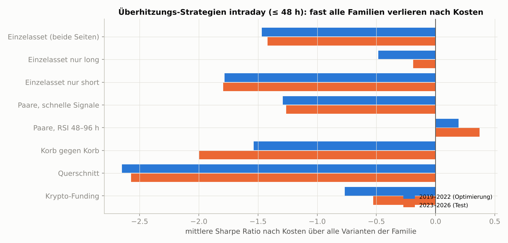
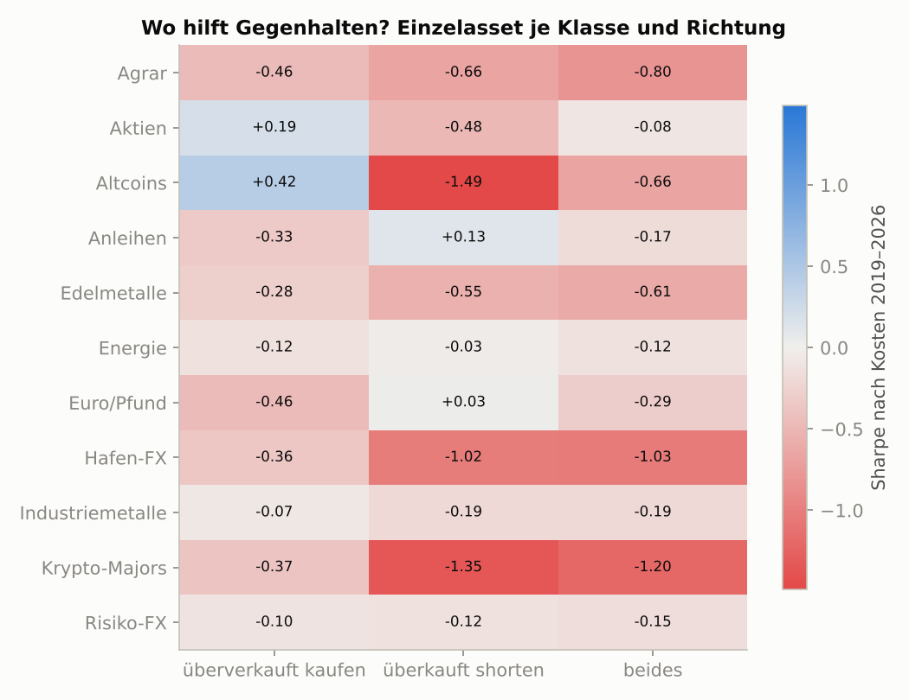
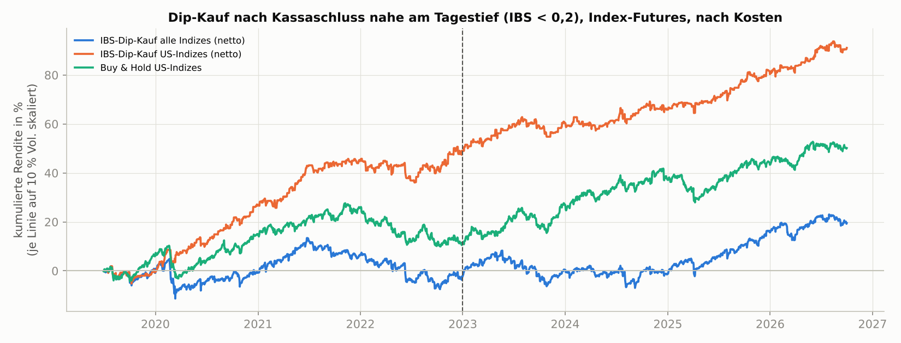
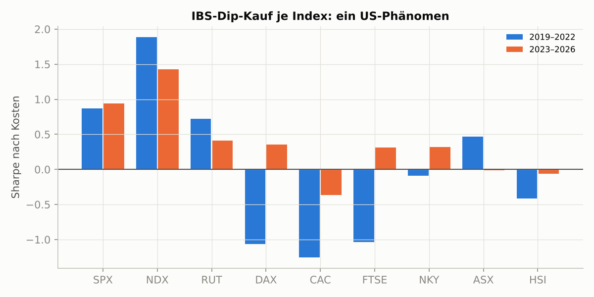
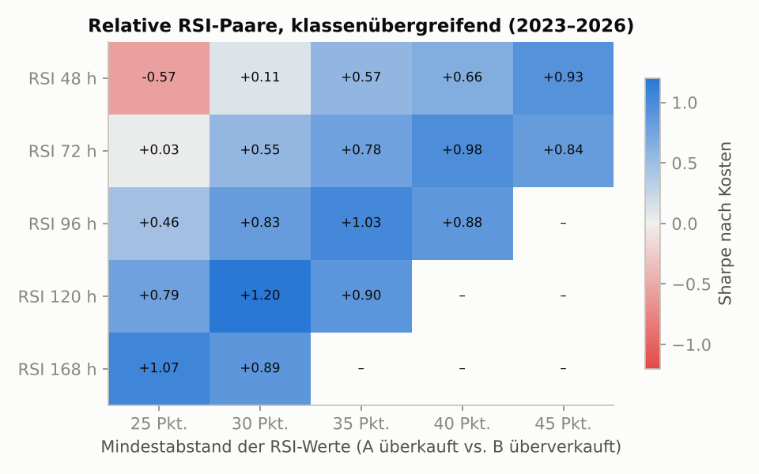
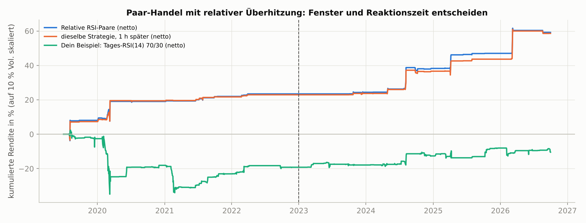

# Panik kaufen trägt – Euphorie shorten verbrennt Geld

Ja, es gibt Überhitzungssignale, die verlässlicher sind als Raten. Es sind aber nur zwei schmale Nischen, und beide folgen demselben Prinzip: **Geld verdienst du, wenn du Panik abkaufst, nicht wenn du Euphorie verkaufst.** Deine Idee in wörtlicher Form – Tages-RSI(14) über 70 short gegen unter 30 long, über alle Paare, überlappend, höchstens zwei Tage – erzeugt in der eigenen Simulation über 63 Märkte (2007–2026) rund 700 Paar-Trades pro Jahr und endet nach Kosten bei einer Sharpe Ratio von **−0,05**. Von 1.243 Stundenvarianten über 42 Märkte sind nur **7 % in Optimierungs- und Testperiode zugleich positiv**. Der Hauptgrund ist eine Asymmetrie, die auch die Forschung kennt. „Überkauft shorten“ verliert in fast jeder Anlageklasse, denn kurzfristig ist Überhitzung meist Schwung und keine Erschöpfung. Ganze Körbe und Anlageklassen zeigen auf Sicht von Stunden bis Wochen eher Momentum als Umkehr. Zwei Dinge tragen. **(A)** Der **Dip-Kauf in US-Aktienindex-Futures zum Kassaschluss**, wenn der Index nahe am Tagestief schließt: Sharpe 1,21 auf Futures 2019–2026 und 0,75 über 19 Jahre ETF-Daten, besser als jede Zufallsvariante. **(B)** Ein **relativer RSI auf mehrtägigen Fenstern**, der überkaufte sichere Häfen gegen ausverkaufte Aktienindizes handelt: Sharpe 0,79, in der Testperiode 1,01. Er hat aber **94 % seines Gewinns an fünf Tagen** verdient und ist deshalb eher eine Krisenoption als ein Dauerläufer. Sentiment-, Positionierungs- und Hebeldaten wie Funding, VIX-Kurve oder COT taugen nach Studienlage und eigenen Tests nicht als Auslöser für Zwei-Tage-Trades, wohl aber als Filter und Größenregler. Meine Empfehlung lautet deshalb: kein Allklassen-System, das in beide Richtungen handelt. Stattdessen A als Hauptmodul und B als kleiner Satellit, beide in LEAN mit eingefrorenen Regeln im Vorwärtstest, mit bescheidenem Risikobudget und vorab festgelegten Kill-Kriterien. Alle Simulationszahlen sind eigene Berechnungen; die Belege stehen im vierten Abschnitt.

## Überhitzung ist meist Schwung – verlässlich kehren nur US-Aktienindizes um

Ein RSI von 75 ist kein Kessel kurz vor dem Platzen, eher ein Zug auf voller Fahrt. Das Thermometer zeigt dir Hitze. Es verrät aber nicht, ob der Motor gleich ausgeht oder gerade erst warm wird. An genau dieser Unterscheidung hängt, ob ein Überhitzungssignal Geld verdient, und die Forschung ist dazu ernüchternd eindeutig.

### Die klassischen Oszillatoren haben ihre beste Zeit hinter sich

Die breiteste Übersicht stammt von Park und Irwin. Von 92 „modernen“ Studien zur technischen Analyse fanden 58 Gewinne, aber konsistent nur „bis Anfang der 1990er-Jahre“. Die meisten leiden unter Data-Snooping, nachträglicher Regelauswahl und schwacher Kostenmodellierung ([Park & Irwin 2004](https://farmdoc.illinois.edu/assets/marketing/agmas/AgMAS04_04.pdf)). In einem gegen Data-Snooping korrigierten Test auf US-Futures (1985–2004) blieben die besten technischen Regeln nur in **2 von 17 Märkten** signifikant profitabel ([Park & Irwin](https://www.researchgate.net/publication/23517440_The_Profitability_of_Technical_Trading_Rules_in_US_Futures_Markets_A_Data_Snooping_Free_Test)). Eine aktuelle, kostenbereinigte Studie zu RSI, Williams %R oder Stochastik auf Horizonten bis zwei Tage gibt es nicht. Die belastbare Evidenz konzentriert sich auf eine einzige Kennzahl und eine einzige Region.

Diese Kennzahl ist die Internal Bar Strength (IBS), die Lage des Schlusskurses innerhalb der Tagesspanne. Pagonidis hat sie für über 30 US-gelistete Index-ETFs von 1993 bis 2013 untersucht. Schließt ein ETF im untersten Fünftel seiner Spanne (IBS < 0,2), steigt er am nächsten Tag im Mittel um **0,35 %**. Schließt er im obersten Fünftel, fällt er um 0,13 % ([Pagonidis](https://www.naaim.org/wp-content/uploads/2014/04/00V_Alexander_Pagonidis_The-IBS-Effect-Mean-Reversion-in-Equity-ETFs-1.pdf)). Der Effekt ist stärker bei hoher Volatilität, nach großen Tagesspannen, in Bärenmärkten und montags. An umsatzschwachen Tagen verschwindet er. Pagonidis nennt ihn ausdrücklich „ein US-zentriertes Phänomen“: Lokale Index-ETFs außerhalb der USA zeigen meist nichts, der DAX-ETF sogar das umgekehrte Muster. Merk dir dieses Detail, es taucht in der eigenen Simulation wieder auf.

Der bekannteste Praktiker-Ableger sind die Connors-Regeln mit RSI(2). Ein unabhängiger SPY-Backtest von 2000 bis 2026 kauft bei RSI(2) unter 10, solange der Kurs über der 200-Tage-Linie liegt. Er kommt auf 82 % Treffer, aber nur auf eine Sharpe von **0,62 gegenüber 0,53 für Kaufen und Halten**, bei durchschnittlich 3,7 Tagen Haltedauer ([gurufinanceinsights](https://gurufinanceinsights.substack.com/p/i-backtested-the-classic-rsi2-mean)). Das liegt über deinem Zwei-Tage-Limit, die Regel müsste also gekappt werden. Dazu kommt Verschleiß. Bei US-Einzelaktien mit ConnorsRSI unter 5 sank die Rendite der Folgewoche von rund 1,5 % (1990–2000) auf etwa 0,3 % (2015–2025) ([Concretum Research](https://x.com/ConcretumR/status/1879572346362593308)). Allgemein verlieren veröffentlichte Renditeprädiktoren danach grob die Hälfte ihrer Wirkung ([Chen, Lopez-Lira & Zimmermann](https://arxiv.org/pdf/2212.10317)). Eine Trefferquote von 80 % klingt nach Sicherheit, ist aber die falsche Messlatte. Entscheidend ist, was nach Kosten pro eingesetztem Risiko übrig bleibt.

### Aktienindizes kehren um, Krypto, Rohstoffe und Währungen laufen weiter

Warum ausgerechnet Aktienindizes? Baltussen, van Bekkum und Da haben 20 Indizes in 15 Ländern untersucht. Die Autokorrelation der Tages- und Wochenrenditen war bis in die 1990er positiv und ist seit den 2000ern negativ ([Baltussen, van Bekkum & Da](https://academicweb.nd.edu/~zda/Indexing.pdf)). Beim S&P 500 kippte das Maß von +0,05 vor März 1999 auf −0,14 danach. Futures und ETFs auf diese Indizes zeigen negative Abhängigkeit „seit ihrer Einführung“. Als Ursache nennen die Autoren die Indexierung: Jeder Prozentpunkt mehr indexiertes Vermögen senkt die serielle Abhängigkeit um rund 0,031. Eine Gegenstrategie erzielte seit 1999 brutto eine **Sharpe von 0,63 über alle Indizes und 0,67 im S&P 500**. Sie „erfordert aber häufiges Umschichten“ und ist nach Kosten für viele Anleger womöglich nicht nutzbar. Die Umkehr in Indizes ist also kein Stimmungseffekt, sondern Mechanik. Die Arbitrage zwischen Futures, ETFs und Einzeltiteln dehnt Bewegungen kurz aus und lässt sie dann zurückfedern.

In den anderen Anlageklassen ist das Bild dünner oder kehrt sich um. Lange US-Anleihen zeigen leichte Umkehr, die nach Korrektur für Mehrfachtests aber nicht signifikant ist. Gold, Silber und breite Rohstoffkörbe verhalten sich auf Tagesbasis wie Zufallsbewegungen ([Portnaya, Preprint mit internen Inkonsistenzen](https://arxiv.org/html/2606.29591v1)). Eine Studie über zwei Jahrhunderte und viele Anlageklassen findet auf Monatssicht „keine Evidenz für kurzfristige Umkehr“, wohl aber starkes kurzfristiges Momentum ([Short-term momentum (almost) everywhere](https://www.sciencedirect.com/science/article/pii/S1042443119300976)). Wöchentliche Umkehr in 24 US-Futures brachte 1983–2000 brutto eine Sharpe von 0,82, war aber bei Kosten von rund 0,16 % je gehandeltem Dollar ausgelöscht ([Quantpedia zu Wang & Yu](https://quantpedia.com/strategies/short-term-reversal-with-futures)). Bei Währungen gibt es verlässliche Umkehr nur in Minutenfenstern rund um die großen Fixings: Der Dollar steigt vor dem Fix und gibt danach nach ([Krohn, Mueller & Whelan, JF 2024](https://onlinelibrary.wiley.com/doi/10.1111/jofi.13306)).

Bitcoin ist das Gegenteil eines Gummibands. Liu und Tsyvinski finden für 2011–2018 tägliches und vor allem wöchentliches Momentum. Auf das oberste Fünftel der Wochenrenditen folgten in der nächsten Woche **+11,2 %**, auf das unterste +2,6 % ([Liu & Tsyvinski](https://www.nber.org/system/files/working_papers/w24877/w24877.pdf)). Kontra-Strategien nach Überreaktionen in BTC, LTC, XRP und DASH sind nicht profitabel ([Caporale & Plastun](https://cesifo.org/DocDL/cesifo1_wp6861.pdf)). Über 15.000 getestete Regeln zeigen für Bitcoin außerhalb der Stichprobe keine Vorhersagbarkeit ([Hudson & Urquhart](https://reading-clone.eprints-hosting.org/85715)). Umkehr gibt es in Krypto nur an zwei Stellen. Die eine sind kleine, illiquide Coins, während „die Handvoll größter Coins tägliches Momentum statt Umkehr“ zeigt ([Zaremba et al. 2021](https://ideas.repec.org/a/eee/finana/v78y2021ics1057521921002349.html)). Die andere ist der 15-Minuten-Takt: Dort liegt der Vorteil bei 1,3 Basispunkten brutto pro Trade, die Kosten für Hin- und Rückweg bei mindestens 5 Basispunkten ([Kitron & Wengrowicz 2026](https://arxiv.org/html/2608.21888v1)).

Für dein Beispiel heißt das: Weder der Bitcoin-Short noch der Gold-Long hat für sich genommen eine verlässliche Umkehrtendenz. Soll die Kombination funktionieren, muss der Vorteil aus dem relativen Abstand kommen. Das ist eine eigene Behauptung, die einen eigenen Beweis braucht.

### Umkehr ist eine Prämie für Liquidität in der Not

Die tiefere Erklärung liefert Nagel. Kurzfristige Umkehrgewinne sind die Vergütung dafür, Liquidität bereitzustellen, wenn andere verkaufen müssen. Eine Fünf-Tage-Umkehrstrategie auf US-Aktien verdiente in der LTCM-Krise 1998 und 2000/01 nahe **1 % pro Tag**. Bis 2007 schrumpfte das auf unter 0,2 %, 2008 „explodierte“ es. Der VIX sagt die Höhe dieser Prämie voraus ([Nagel, Evaporating Liquidity](https://www.nber.org/papers/w17653.pdf)). Dazu passt, dass Kursschocks ohne Nachricht eher umkehren und Schocks mit Nachricht eher weiterlaufen ([Savor 2012](https://repository.upenn.edu/fnce_papers/387)). Ein gutes Umkehrsignal misst also nicht „Hitze“, sondern erzwungenes Verkaufen ohne neue Information.

Daraus folgt ein unbequemes Dilemma: Am meisten zu verdienen gibt es, wenn der Boden am stärksten bebt. Trendfilter wie die 200-Tage-Linie halten dich aus Crashs heraus, verpassen aber genau diese Momente ([gurufinanceinsights](https://gurufinanceinsights.substack.com/p/i-backtested-the-classic-rsi2-mean)). Feste Stop-Loss-Marken helfen nicht. In einem Backtest, der als einzige Änderung einen 5-%-Stopp einführte, fiel die Jahresrendite eines Mean-Reversion-Systems von rund 8,2 % auf etwa 1 %. Der schlimmste Drawdown vertiefte sich dabei von −19 % auf −42 % ([setup4alpha](https://setup4alpha.substack.com/p/stop-loss-mean-reversion-backtest)). Wirklich gefährlich ist das Nachkaufen in Verluste hinein. Genau das brach Close-to-Close-Umkehrstrategien im März 2020 das Genick ([Quant Bust 2020](https://arxiv.org/pdf/2006.05632)). Ohne Bremsen endet naives Dip-Kaufen in Krypto-Bärenmärkten im Mittel bei **−40,6 %** ([CoinQuant](https://www.coinquant.ai/blog/building-a-mean-reversion-strategy-in-cryptocurrency-markets-evidence-from-78-backtests)). Für deinen Zwei-Tage-Rahmen ist deshalb der Zeitstopp die natürliche Bremse. Dazu kommen Positionsgrößen, die sich an der Volatilität orientieren, und ein Verbot, dasselbe Signal aufzustocken.

## Relative Überhitzung braucht ein Gummiband – zwischen Bitcoin und Gold gibt es keins

Paarhandel funktioniert wie zwei Hunde an einer gemeinsamen Leine. Sie können auseinanderziehen, aber die Leine holt sie zurück. Bitcoin und Gold hängen an keiner Leine. Sie sind zwei Hunde, die zufällig im selben Park spazieren. Rennt einer davon, holt ihn nichts zurück.

### Entscheidend ist, wie schnell die Leine zieht

Alle gängigen Verfahren lassen sich auf Stunden- oder Tagesdaten anwenden: Distanzmethode, Kointegration, Ornstein-Uhlenbeck-Modelle, Copulas und Faktorresiduen ([Krauss-Review](https://www.iwf.rw.fau.de/files/2016/03/09-2015.pdf)). Ob ein Verfahren zu zwei Tagen Haltedauer passt, entscheidet die Rückkehrgeschwindigkeit des Spreads, gemessen als Halbwertszeit ln(2)/κ. Avellaneda und Lee modellieren die Residuen von Aktien gegenüber Faktoren als OU-Prozess. Sie handeln nur, wenn die Rückkehrzeit unter der Hälfte des Schätzfensters liegt (κ > 8,4). Sinkt κ darunter, eröffnen sie nichts mehr und schließen offene Positionen. Nach Kosten erreichten sie damit eine **Sharpe von 1,44 für 1997–2007, aber nur 0,9 für 2003–2007** ([Avellaneda & Lee](https://www.math.nyu.edu/faculty/avellane/AvellanedaLeeStatArb20090616.pdf)). In dieser Systematik ist dein relativer RSI ein Sonderfall: ein z-Wert des Preisverhältnisses mit festem 1:1-Hedge, ohne jeden Test, ob das Verhältnis überhaupt zu einem Mittelwert zurückkehrt.

Der Zerfall solcher Strategien ist gut dokumentiert. Bei US-Aktienpaaren (1962–2014) sanken die monatlichen Überrenditen nach Kosten auf 38 Basispunkte (Distanz), 33 (Kointegration) und 5 (Copula). Ab 2009 gab es zudem deutlich weniger Handelsgelegenheiten ([Rad, Low & Faff](https://research.bond.edu.au/en/publications/the-profitability-of-pairs-trading-strategies-distance-cointegrat/)). Ein maschinell gelerntes Ein-Tages-Umkehrsystem auf den S&P 500 verdiente nach Kosten im Gesamtzeitraum 0,25 % pro Tag, **verlor aber 2010–2015 zwischen 14 und 25 % pro Jahr** ([Krauss, Do & Huck](https://www.iwf.rw.fau.de/files/2016/03/03-2016.pdf)). Komplexität schützt also nicht vor Verfall.

Überlebt hat, was eine physische oder vertragliche Leine hat. Der Crack-Spread zwischen Rohöl und Raffinerieprodukten brachte über 15 % pro Jahr nach Kosten, weil es einen „klaren fundamentalen Grund“ für die Kointegration gibt. Der Gold-Silber-Spread blieb dagegen „erfolglos“ ([Krauss-Review](https://www.iwf.rw.fau.de/files/2016/03/09-2015.pdf)). Besonders aufschlussreich ist ein Test von 2026. US-Fonds, deren Inventarwert an Krypto oder Metalle gekoppelt ist, erben die Kurzfrist-Umkehr ihres Basiswerts. Nur korrelierte Kontrollinstrumente zeigen dagegen in **0 von 5 Fällen** etwas ([Kitron & Wengrowicz](https://arxiv.org/html/2608.21888v1)).

Für Paare wie Bitcoin gegen Gold oder Nasdaq gegen Bund gibt es keine einzige akademische Kurzfrist-Studie. Was es gibt, spricht gegen eine stabile Leine. Die Korrelation zwischen Bitcoin und Gold ist schwach, hängt vom Regime ab und lag fast immer unter der zwischen Bitcoin und Aktien ([Deribit Insights](https://insights.deribit.com/?p=54429)). Die 36-Monats-Korrelation zwischen Aktien und Anleihen sprang von −0,37 (2011–2021) auf +0,41 nach 2022 ([State Street](https://www.ssga.com/library-content/assets/pdf/global/wmu/2025/mom-20251003.pdf)). Ein Extremwert im Verhältnis zweier solcher Assets ist deshalb eher der Abdruck eines gemeinsamen Treibers, etwa Risikoappetit, Realzinsen oder Inflationsregime, als eine vorübergehende Verrenkung.

### Körbe laufen im Gleichschritt weiter

Noch klarer ist die Lage bei Körben. Wo die Forschung kurzfristige Umkehr findet, betrifft sie einzelne Titel innerhalb einer homogenen Gruppe. Bei Einzelaktien stammt die Umkehr aus Bewegungen innerhalb der Branche, ganze Branchen laufen im Folgemonat dagegen weiter ([Moskowitz & Grinblatt](https://ideas.repec.org/a/bla/jfinan/v54y1999i4p1249-1290.html); [NY Fed Staff Report 513](https://www.newyorkfed.org/medialibrary/media/research/staff_reports/sr513.html)). Auf den höheren Ebenen herrscht Schwung. Länder- und Branchenindizes zeigen kurzfristiges Alpha-Momentum ([Zaremba, Umutlu & Karathanasopoulos](https://napier-repository.worktribe.com/output/3011105/alpha-momentum-and-alpha-reversal-in-country-and-industry-equity-indexes)), Währungen über ein bis vier Wochen Querschnitts-Momentum ([Raza](https://mro.massey.ac.nz/handle/10179/7266)). Bei Rohstoffen sind Umkehrstrategien „durchweg unprofitabel“ ([White Rose](https://eprints.whiterose.ac.uk/id/eprint/159905/3/Do%20momentum%20and%20reversal%20strategies%20work%20in%20commodity%20futures%20A%20comprehensive%20study%20ACCEPTED%20VERSION.pdf)). Einen überhitzten Korb gegen einen unterkühlten zu verkaufen, zielt also genau auf die Ebene, auf der die Daten Schwung statt Rückfederung zeigen.

### Viele Paare bringen viele Zufallstreffer

Wer N Märkte paarweise testet, prüft N(N−1)/2 Paare. Bei 63 Märkten sind das 1.953, und dabei sind Fenster, Schwellen und Haltedauern noch nicht variiert. Unter so vielen Versuchen glänzt immer irgendein Zufallstreffer. Die Deflated Sharpe Ratio rechnet das heraus, indem sie Zahl, Streuung und Abhängigkeit der Versuche berücksichtigt ([Bailey & López de Prado](https://papers.ssrn.com/abstract=2460551)). Harvey, Liu und Zhu fordern für neue Faktoren eine t-Statistik um 3 statt 2, weil „die meisten behaupteten Forschungsbefunde in der Finanzökonomie wahrscheinlich falsch“ seien ([Harvey, Liu & Zhu](https://nber.org/papers/w20592)). An diese Messlatte halte ich unten die eigenen Kandidaten.

Selbst echte Umkehrkanten haben eine dunkle Seite. Im August 2007 verlor ein täglicher Kontra-Korb bis zum 9. August 1,75 % und lag nach fünf Tagen doch bei +3,44 %. Fünf-Tage-Positionen, die am 8. und 9. August eröffnet wurden, verdienten ohne Hebel 8,2 und 9,0 % ([Khandani & Lo](https://nber.org/system/files/working_papers/w14465/w14465.pdf)). Wer aber mit dem damals üblichen Hebel von 4:1 bis 10:1 handelte, wurde genau am Tiefpunkt zum Aufgeben gezwungen. Im Sommer 2025 verloren Quant-Aktienfonds rund 4,2 %, während der Markt um etwa 8 % stieg ([MSCI](https://www.msci.com/research-and-insights/blog-post/unraveling-summer-2025s-quant-fund-wobble)). Für überlappende Positionen folgt daraus eine einfache Regel. Laufen „BTC short gegen Gold“ und „BTC short gegen Anleihen“ gleichzeitig, hast du nicht zwei Wetten, sondern eine doppelt so große Bitcoin-Wette. **Limits gehören auf die Nettoposition je Asset, nicht auf das einzelne Paar.**

## Fieberthermometer für Gier und Angst messen Wochen, nicht Stunden

Sentiment- und Positionierungsdaten funktionieren wie ein Barometer. Sie sagen dir, dass ein Gewitter wahrscheinlicher wird, aber nicht, wann der erste Tropfen fällt. Für Trades von höchstens zwei Tagen ist genau das der Haken.

### Krypto-Hebel zeigt die Fallhöhe, nicht den Zeitpunkt

Die solideste Krypto-Studie stammt von der BIS. Die Basis zwischen Futures und Spot liegt im Mittel über 10 % pro Jahr, zeitweise bei bis zu 60 %, und **„hohe Carry sagt künftige Crashs voraus“** ([BIS WP 1087](https://www.bis.org/publ/work1087.pdf)). Über welchen Zeitraum diese Vorhersage gilt, ließ sich allerdings nicht prüfen. Abweichungen zwischen Perpetual-Futures und Spot schließen sich zuverlässig wieder. Das trägt eine Arbitrage mit Sharpe 1,8 (BTC) bis 4,8 (BNB), ist aber gerade keine Wette auf die Kursrichtung ([He, Manela, Ross & von Wachter](https://arxiv.org/html/2212.06888v5)). Eine Regression achtstündiger BTC-Renditen auf das Funding kam auf ein R² von 0,003 ([Fulgur Ventures](https://medium.com/@fulgur.ventures/bitcoin-funding-rates-and-price-predictability-27ce95535af1)). Weil das Funding in über 92 % der Perioden positiv ist, muss man „hoch“ relativ zur strukturellen Basis von 0,01 % je acht Stunden definieren, nicht relativ zu null ([BitMEX](https://testnet.bitmex.com/blog/2025q3-derivatives-report)).

Eine eigene Kurzauswertung während der Recherche zeigt ein lehrreiches Muster. Sie ist naiv gerechnet, in-sample und ohne Kosten, auf frei verfügbaren [Binance-Funding-Daten](https://data.binance.vision/?prefix=data/futures/um/monthly/fundingRate/BTCUSDT/). Nach sehr negativem Funding (unterstes Zehntel) stieg Bitcoin in den folgenden 24 Stunden im Mittel um 0,60 %, gegenüber 0,10 % ohne Bedingung (t ≈ 2,2). Das ist ein Short-Squeeze-Effekt. Er stammt aber fast vollständig aus 2020–2022 und ist 2023–2026 statistisch verschwunden. Extrem positives Funding zog in keiner Periode eine verlässliche Umkehr nach sich.

Beim Crypto Fear & Greed Index ist es ähnlich. Auf Werte über 80 folgten keine Rückschläge, sondern weitere Gewinne: +0,54 % in 24 Stunden (eigene Kurzauswertung auf [alternative.me-Daten](https://api.alternative.me/fng/?limit=0)). Die Literatur sieht seinen Vorlauf bei einer Woche bis einem Monat ([Albrecht et al.](https://journal.fsv.cuni.cz/mag/article/show/id/1548)).

Die eigene Stunden-Simulation bestätigt das. **Alle 27 getesteten Varianten mit Funding-Extremen verlieren nach Kosten**, im Mittel −0,77 in der Optimierungs- und −0,53 in der Testperiode (eigene Berechnung: [funding_grid.csv](../results/meanrev_hourly/funding_grid.csv)). Liquidationskaskaden wie am 10. Oktober 2025 lösten rund 19 Mrd. USD gehebelter Positionen auf, zu fast 90 % Longs ([21Shares](https://www.21shares.com//research/record-crypto-liquidations-amid-tariff-shock)). Solche Kaskaden kündigen sich nur an, wenn sich der Hebel von innen aufbaut. Bei Nachrichtenschocks gibt es keine Vorwarnung ([arXiv 2607.27070](https://arxiv.org/abs/2607.27070)).

### Bei Aktien wirkt nur der mechanische Absicherungsfluss schnell

Bei Aktien schneiden die klassischen Stimmungsmaße schwach ab. Auf einen VIX am Zweijahreshoch folgen leicht positive Renditen über ein bis fünf Tage, statistisch signifikant, ökonomisch aber klein, und das an nur rund 54 von 6.000 Tagen ([CXO zu Bandelli & Wang](https://cxoadvisory.com/equity-premium/revisiting-vix-as-stock-return-predictor)). Eine invertierte VIX-Kurve trat seit 2010 an weniger als 20 % der Tage auf und hat außerhalb der größten Ausverkäufe nicht verlässlich weitere Verluste angekündigt ([Cboe](https://www.cboe.com/insights/posts/inside-volatility-trading-is-vix-backwardation-necessarily-a-sign-of-a-future-down-market)). Put/Call-Ratios hängen auf Indexebene „sehr schwach“ und teils mit falschem Vorzeichen mit künftigen Renditen zusammen ([CXO](https://www.cxoadvisory.com/sentiment-indicators/predictive-power-of-put-call-ratios)), und der CNN Fear & Greed Index hat seit 2021 deutlich an Vorhersagekraft verloren ([Farrell & O'Connor](https://ideas.repec.org/a/eee/finlet/v72y2025ics1544612324015216.html)).

Wie gefährlich feste Regeln hier sind, zeigt eine eigene Kurzauswertung der Cboe-Daten. Lag das Verhältnis VIX/VIX3M über 1,1, folgten 2009–2016 im Mittel +1,84 % in fünf Tagen, 2017–2026 aber **−1,37 %**: Das Vorzeichen hat sich gedreht ([VIX](https://cdn.cboe.com/api/global/us_indices/daily_prices/VIX_History.csv), [VIX3M](https://cdn.cboe.com/api/global/us_indices/daily_prices/VIX3M_History.csv), [SPX](https://cdn.cboe.com/api/global/us_indices/daily_prices/SPX_History.csv)).

Der einzige gut belegte schnelle Mechanismus sind erzwungene Absicherungsflüsse. In über 60 Futures-Märkten sagt die Rendite des übrigen Handelstags die Rendite der letzten 30 Minuten positiv voraus. Dieser Effekt kehrt sich in den folgenden Tagen um und hängt mit der Absicherung von Short-Gamma-Positionen zusammen ([Baltussen, Da, Lammers & Martens, JFE 2021](https://repub.eur.nl/pub/131621)). Ist die aggregierte Gamma-Position von Optionshändlern und gehebelten ETFs stark negativ, entsteht Momentum bis zum Handelsschluss. Dieser Preisdruck löst sich am nächsten Handelstag auf, wobei der Beitrag der gehebelten ETFs über die Jahre schwächer geworden ist ([Barbon, Beckmeyer, Buraschi & Moerke](https://papers.ssrn.com/abstract=3925725)). Das ist der wahrscheinlichste Motor hinter dem Dip-Kauf zum Kassaschluss, den die eigene Simulation als stärksten Kandidaten ausweist. Eine freie tägliche Schätzung der Händler-Gamma (GEX) für den S&P 500 gibt es seit 2011 ([SqueezeMetrics](https://squeezemetrics.com/monitor/static/DIX.csv)).

### COT und CTA-Schätzungen sind Landkarten, keine Startschüsse

Die CFTC-Positionsdaten bilden den Stand vom Dienstag ab und erscheinen freitags um 15:30 Uhr New Yorker Zeit ([CFTC](https://www.cftc.gov/MarketReports/CommitmentsofTraders/index.htm)). Für zwei Tage Haltedauer kommen sie zu spät. Zudem sagen die Positionen der Spekulanten die Folgewoche nicht voraus, weder bei Währungen ([Klitgaard & Weir](https://www.newyorkfed.org/research/epr/04v10n1/0405klit/0405klit.html)) noch bei Agrarrohstoffen ([Sanders, Irwin & Merrin](https://ageconsearch.umn.edu/record/54547/files/JARE_Aug09__04R_pp276-296.pdf)). Kurzfristige Positionsänderungen spiegeln vor allem den Liquiditätsbedarf der Spekulanten ([Kang, Rouwenhorst & Tang](https://ideas.repec.org/a/bla/jfinan/v75y2020i1p377-417.html)). Nach neuerer Arbeit derselben Gruppe kündigt das Netto-Handeln der Spekulanten bei Rohstoffen eine Umkehr in der Folgewoche an ([Seminar-Abstract Lingnan](https://lingnan.sysu.edu.cn/en/event/3656)).

Wie lange eine Überfüllung andauern kann, zeigt der Yen. Die Netto-Shortposition der Spekulanten baute sich über rund drei Monate auf, überstand die Interventionen von Ende April und Mai 2024 und erreichte am 2. Juli 2024 mit **−184.223 Kontrakten** ihr Extrem. Erst im Juli und August löste sie sich binnen weniger Wochen auf ([CFTC-API](https://publicreporting.cftc.gov/resource/6dca-aqww.json)). 2026 wiederholte sich das Muster: −163.412 Kontrakte am 28. Juli, +120.000 Mitte September ([CFTC-API](https://publicreporting.cftc.gov/resource/6dca-aqww.json)). Im Frühjahr davor hatte Japan mit Rekordinterventionen gegengehalten ([NST/Bernama](https://www.nst.com.my/amp/business/economy/2026/05/1431231/japan-spends-more-us30bil-prop-yen)). Überfüllung ist die gespannte Feder, der Auslöser kommt von außen.

Für Schätzungen der CTA-Positionierung gibt es keinen öffentlichen Test, der zeigt, dass „maximal long“ eine kurzfristige Umkehr ankündigt. Volatilitäts-Zielfonds bauen nach einem Volatilitätsschub mechanisch über Tage ab ([Acadian](https://www.acadian-asset.com/investment-insights/managing-risk/defensive-investing-strategies-feedback-loops-and-echoes-of-1987)). Das spricht eher dagegen, schon am ersten Tag eines Schocks zu kaufen. Bankkomposite wie der BofA Bull & Bear Indicator arbeiten auf Monatssicht: 16 Verkaufssignale seit 2002, danach im Mittel −2,4 % für globale Aktien ([Fortune](https://fortune.com/2025/12/19/stocks-bank-of-america-warns-contrarian-sell-signal)).

| Indikator | Was er in ≤ 2 Tagen leistet | Rolle im System |
|---|---|---|
| Krypto-Funding, Basis, Open Interest | Squeeze nach negativem Funding 2020–22, seither verschwunden; positive Extreme ohne Umkehr | Fragilitäts- und Größenfilter für Krypto-Beine |
| Crypto Fear & Greed | keine Kontra-Kante; extreme Gier läuft weiter | nur Regimekennzeichen |
| VIX-Niveau, VIX/VIX3M | kleine positive Drift nach Extremen; Vorzeichen instabil | Erlaubnis und Größenregler für Dip-Käufe |
| Händler-Gamma (GEX), Flüsse gehebelter ETFs | Momentum zum Schluss, Rückfederung am Folgetag | erklärt Kandidat A; späterer Filterkandidat |
| Put/Call, TRIN, AAII, CNN F&G | schwach bis verfallen | keine |
| COT, CTA-Schätzungen | keine Wochenprognose; Überfüllung braucht Auslöser | langsame Risikokarte |
| BofA-, GS-, Citi-Komposite | Monatshorizont, kleine Stichproben | keine |

## 1.243 Varianten, zwei Überlebende: was die eigene Simulation zeigt

Alle Zahlen dieses Abschnitts sind **eigene Berechnungen** aus dem Repository MF_Trader, keine externen Quellen. Der Code liegt in [`mf_trader/overheat.py`](../mf_trader/overheat.py), [`mf_trader/meanrev.py`](../mf_trader/meanrev.py), [`mf_trader/stats.py`](../mf_trader/stats.py) und unter [`scripts/`](../scripts/). Die Ergebnisse liegen in [`results/meanrev_hourly/`](../results/meanrev_hourly/), [`results/meanrev_daily/`](../results/meanrev_daily/), [`results/user_rsi_example/`](../results/user_rsi_example/), [`results/dip_buying/`](../results/dip_buying/), [`results/ibs_futures_hourly/`](../results/ibs_futures_hourly/) und [`results/pair_rsi_deepdive/`](../results/pair_rsi_deepdive/). Alle Werte gelten nach Kosten, sofern nicht „brutto“ dasteht.

### Der Versuchsaufbau ist breiter als im ersten Bericht

Das Universum ist deutlich größer als im [ersten Bericht](../reports/Kapitalrotation%20und%20Money%20Flow%20Trading.md). Die Stundendaten von Juli 2019 bis September 2026 umfassen **42 Märkte in 11 Körben**: zehn Aktienindizes, drei Staatsanleihen-Futures, Gold und Silber, Kupfer, Brent und Erdgas, vier Agrarrohstoffe, zehn Währungen gegen den Dollar sowie Bitcoin, Ether und acht Altcoins. Die Tagesdaten von 2007 bis 2026 umfassen **63 ETFs und Kryptowerte**.

Getestet wurden RSI über 6 bis 168 Stunden bzw. 2 bis 14 Tage, dazu z-Werte, Bollinger-Abstände, IBS, PCA-Residuen nach Avellaneda/Lee und Krypto-Funding. Die Grundregel folgt deiner Idee: überhitzt short, unterkühlt long. Ausgestiegen wird, sobald sich die Einschätzung auflöst, spätestens nach 12, 24 oder 48 Stunden bzw. nach ein oder zwei Tagen. Alle Paare laufen gleichzeitig und überlappend und werden je Asset netto verrechnet. Körbe sind risikogleich gewichtet.

Zur Ausführung: Auf Stundenbasis wird in der nächsten Stunde bei offenem Markt gehandelt, mit 0,5–8 Basispunkten Kosten je Seite plus Stressaufschlag. Auf Tagesbasis wird zum Schlusskurs gehandelt und als konservative Variante zur nächsten Eröffnung. Optimiert wurde auf 2019–2022 bzw. 2007–2016, getestet auf 2023–2026 bzw. 2017–2026. Dazu kamen Placebo-Tests, Deflated Sharpe Ratio, Ausschlusstests, Verzögerungen und doppelte Kosten.

Eine Datenfalle verdient Erwähnung, weil sie jedes Überhitzungssystem ruinieren kann. Die freien Rohstoff-CFDs von Dukascopy rollen monatlich in den nächsten Kontrakt, mit großen Kurslücken, beim Erdgas **bis ±34 % in einer Stunde**. Ohne Bereinigung erzeugt jeder Kontraktwechsel ein falsches „überhitzt“. Entfernt wurden 35 Roll-Stunden beim Erdgas, 21 bei Soja, 13 bei Zucker, 9 bei Kakao und 4 bei Kaffee (eigene Berechnung: [data_cleaning_report.json](../results/meanrev_hourly/data_cleaning_report.json)). Für deinen Bot heißt das: Futures-Reihen ohne saubere Rückwärtsanpassung sind für Überhitzungssignale Gift.

### Deine Idee wörtlich: 700 Trades im Jahr für fast nichts

Zuerst der wörtliche Test. Gemessen wird der Tages-RSI(14). Liegt Markt A bei 70 oder darüber und Markt B bei 30 oder darunter, geht A short und B long. Ausgestiegen wird, sobald einer der beiden RSI die 50 kreuzt, spätestens nach zwei Tagen. Das läuft über alle 1.953 Paare von 63 Märkten. Von 2007 bis 2026 ergibt das rund 13.450 Paar-Trades, also etwa 700 pro Jahr. Im Mittel bringt ein Paar-Trade +0,17 % brutto bei 53 % Treffern und 2,0 Tagen Haltedauer. Meist greift also der Zeitstopp, bevor sich die Einschätzung auflöst. Als überlappendes, netto verrechnetes Portfolio bleiben **eine Sharpe von 0,12 brutto und −0,05 netto** zum Schlusskurs bzw. −0,09 bei Ausführung zur nächsten Eröffnung. Der zeitliche Verlauf ist bezeichnend: 2007–2016 noch +0,18, 2017–2026 −0,23 (eigene Berechnung: [user_rsi_example.csv](../results/user_rsi_example/user_rsi_example.csv)).

Strengere Schwellen helfen kaum. Bei 80/20 bleiben rund 13 Trades pro Jahr mit einer Sharpe von 0,23 zum Schlusskurs bzw. 0,09 zur Eröffnung, zu wenige für eine belastbare Aussage. Bei 90/10 gibt es gar keine Signale, weil ein 14-Tage-RSI so selten so weit ausschlägt. Der schnellere RSI(2) kommt mit 90/10 bzw. 95/5 auf −0,46 bzw. −0,17, weil die Kosten der vielen Trades den Bruttovorteil auffressen. Auf Stundendaten mit Ausführung in der nächsten Stunde liegt RSI(14) 70/30 bei −0,14, mit schlechter Optimierungsperiode (−0,41) und guter Testperiode (+0,40). Das ist das typische Bild eines Signals ohne stabilen Vorteil.

Und dein konkretes Paar? Die Konstellation Bitcoin ≥ 70 und Gold ≤ 30 oder umgekehrt trat auf Tagesbasis **ganze dreimal** auf. Im November 2020 brachte „Gold long, Bitcoin short“ +4,7 %, im August 2021 +0,4 %. Dazwischen lag im Mai 2021 der umgekehrte Fall: Bitcoin war überverkauft, fiel weiter, und der Trade kostete −8,6 % in zwei Tagen (brutto, gleich gewichtet; eigene Berechnung: [daily_rsi14_7030_trades.csv](../results/user_rsi_example/daily_rsi14_7030_trades.csv)). Auf Stundenbasis waren es vier Einstiege mit zusammen +0,46 % netto ([btc_gold_example.json](../results/user_rsi_example/btc_gold_example.json)). Das ist keine Strategie, sondern eine Anekdote mit Kursrisiko.

### Überblick: Die Short-Seite und die Körbe ziehen alles nach unten

*Eigene Berechnung (Repo MF_Trader, [m01_data.csv](../results/charts_meanrev/m01_data.csv)). Mittlere Sharpe Ratio nach Kosten über alle Varianten jeder Familie, blau 2019–2022 (Optimierung), orange 2023–2026 (Test).*

Von allen 1.243 Stundenvarianten sind 15 % in der Optimierungsperiode positiv, 16 % in der Testperiode und **nur 7 % in beiden**. Die mittlere Sharpe liegt schon vor Kosten bei −0,15 (eigene Berechnung: [summary.json](../results/meanrev_hourly/summary.json); [all_trials.csv](../results/meanrev_hourly/all_trials.csv)). Die Familien unterscheiden sich deutlich (Mittelwerte Optimierung / Test; [m01_data.csv](../results/charts_meanrev/m01_data.csv)):

| Familie | Optimierung 2019–22 | Test 2023–26 |
|---|---|---|
| Einzelasset, beide Richtungen | −1,47 | −1,42 |
| Einzelasset, nur long | −0,48 | −0,19 |
| Einzelasset, nur short | −1,78 | −1,79 |
| Paare, schnelle Signale (RSI 14 h, z-Werte über 12–48 h, PCA-Residuen) | −1,29 | −1,26 |
| Korb gegen Korb | −1,54 | −2,00 |
| Querschnitt | −2,65 | −2,57 |
| Krypto-Funding | −0,77 | −0,53 |
| **Paare mit langsamem RSI über 48–96 Stunden** | **+0,19** | **+0,37** |

Nur die letzte Familie ist positiv. Bemerkenswert ist, dass Korb- und Querschnittsvarianten **selbst vor Kosten im Mittel verlieren** (−0,38 bzw. −0,46 brutto; [baskets_xs_grid.csv](../results/meanrev_hourly/baskets_xs_grid.csv)). Das ist kein Kostenproblem, sondern Schwung, genau wie es die Literatur zu Branchen, Ländern und Währungen erwarten lässt. Das beste Korb-Setup der Optimierung (+0,33) kippte im Test auf −0,73. Auch die komplexeren Modelle wie PCA-Residuen haben nichts gerettet.

*Eigene Berechnung (Repo MF_Trader, [m02_data.csv](../results/charts_meanrev/m02_data.csv)). Blau: Gegenhalten lohnt, rot: Gegenhalten verliert.*

Die Aufteilung nach Klasse und Richtung zeigt die Asymmetrie im Detail. „Überverkauft kaufen“ ist nur bei Altcoins (+0,42) und Aktien (+0,19) leicht positiv. „Überkauft shorten“ verliert fast überall, am stärksten bei Altcoins (−1,49), Krypto-Majors (−1,35) und Hafenwährungen (−1,02). Die einzige Ausnahme sind Anleihen (+0,13) ([m02_data.csv](../results/charts_meanrev/m02_data.csv)). In Stressphasen mit hoher Aktienvolatilität kommt „Aktien überverkauft kaufen“ in der Testperiode auf **+0,98** ([conditioning.csv](../results/meanrev_hourly/conditioning.csv)). Das ist Nagels Liquiditätsprämie in Reinform. Wer überkaufte Märkte shortet, stellt sich vor einen anfahrenden Zug. Wer Panikverkäufe abkauft, steht an der Rampe, an der andere ihre Ware loswerden müssen.

Die Tagesdaten 2007–2026 erzählen dieselbe Geschichte eine Etage höher. Von 160 Einzelasset-Varianten ist keine einzige in der Testperiode positiv; nur US-Aktien sind leicht positiv, mit IBS 0,71 in der Optimierung und 0,25 im Test. Von 88 Paarvarianten ist 1 % in der Testperiode positiv, und die Ergebnisse einzelner Paare in Optimierung und Test korrelieren nur zu **0,09**. Gute Paare der Vergangenheit sagen also nichts über die Zukunft. Korb gegen Korb kommt brutto auf +0,20, netto auf −0,46 (Optimierung) bzw. −0,69 (Test), der Querschnitt auf −1,3 bzw. −1,7, klassenneutral sogar auf −2,0 bzw. −2,4. Konditionierung hilft nur auf der Long-Seite: IBS nur long über alle Märkte steigt mit hohem VIX von 0,18 auf 0,44, nur short bleibt durchweg negativ ([single_asset_grid.csv](../results/meanrev_daily/single_asset_grid.csv); [pairs_grid.csv](../results/meanrev_daily/pairs_grid.csv); [baskets_xs_grid.csv](../results/meanrev_daily/baskets_xs_grid.csv); [conditioning.csv](../results/meanrev_daily/conditioning.csv)).

### Kandidat A: Der Dip-Kauf zum US-Kassaschluss besteht jeden Test

Die Regel ist schlicht. Schließt ein Aktienindex in den unteren 20 % seiner Tagesspanne (IBS < 0,2), wird er zum Schluss gekauft. Verkauft wird nach einem späteren Schluss mit IBS über 0,5, spätestens nach zwei Tagen. Short-Signale gibt es keine. Auf Tagesdaten 2007–2026 mit 15 Aktienindex-ETFs erreicht das eine **Sharpe von 0,75 netto** (2007–2016: 0,80, 2017–2026: 0,69) und 1,02 brutto. Kaufen und Halten desselben Korbs kommt auf 0,37. Auf 10 % Volatilität skaliert sind das 7,2 % pro Jahr bei einem maximalen Drawdown von −16 %. 16 von 20 Jahren waren positiv, 2008 sogar mit +0,9 % (eigene Berechnung: [dip_buying_grid.csv](../results/dip_buying/dip_buying_grid.csv); [buyhold_reference.json](../results/dip_buying/buyhold_reference.json)). Ein VIX-Filter, der nur bei VIX über dem Median handelt, streicht gut 40 % der Signale bei praktisch gleicher Sharpe (0,78).

Der wichtigste Befund steckt im Kleingedruckten. Wird erst zur nächsten Eröffnung eingestiegen, **fällt die Sharpe auf 0,22**. Ein großer Teil des Effekts ist die Erholung über Nacht. Der Einstieg muss deshalb zum Kassaschluss oder direkt danach erfolgen, bei Futures in der Stunde danach.

Der Placebo-Test stellt sicher, dass hier nicht bloß ein Aufschlag für Aktienrisiko gemessen wird. Dafür liefen 300 Durchläufe mit zufälligen Einstiegen bei gleicher Zahl und Haltedauer. Im US-Korb (SPY, QQQ, IWM) kamen sie im Mittel auf 0,38 (95-%-Quantil 0,64), die echte Regel auf 0,98. Über alle 15 Indizes steht 0,75 gegen 0,06. **Keiner der Zufallsdurchläufe erreicht die echte Regel** ([ibs_placebo.json](../results/dip_buying/ibs_placebo.json)).

*Eigene Berechnung (Repo MF_Trader, [curve.csv](../results/ibs_futures_hourly/curve.csv)). Jede Linie auf 10 % Volatilität skaliert; rechts der gestrichelten Linie liegt die Testperiode.*

Ob das mit handelbaren Instrumenten funktioniert, zeigt der Test mit Index-Futures auf Stundendaten 2019–2026. Die IBS jedes Index wird aus den Stundenschlusskursen seiner Kassasitzung angenähert. Eingestiegen wird in der Stunde nach dem Kassaschluss, gerechnet wird mit Futures-Kosten (eigene Berechnung: [ibs_futures_hourly.csv](../results/ibs_futures_hourly/ibs_futures_hourly.csv); [us_basket_summary.json](../results/ibs_futures_hourly/us_basket_summary.json)).

| Index | Sharpe netto 2019–2026 | 2019–2022 | 2023–2026 |
|---|---|---|---|
| S&P 500 | 0,91 | 0,87 | 0,94 |
| Nasdaq 100 | 1,64 | 1,89 | 1,42 |
| Russell 2000 | 0,56 | 0,72 | 0,41 |
| DAX | −0,37 | −1,06 | 0,36 |
| CAC 40 | −0,82 | −1,25 | −0,36 |
| FTSE 100 | −0,40 | −1,03 | 0,31 |
| Nikkei 225 | 0,12 | −0,09 | 0,32 |
| ASX 200 | 0,24 | 0,47 | −0,01 |
| Hang Seng | −0,23 | −0,41 | −0,06 |
| **US-Korb (S&P, Nasdaq, Russell)** | **1,21** | **1,31** | **1,12** |
| Kaufen und Halten US-Korb | 0,67 | 0,31 | 1,01 |

Der US-Korb erreicht auf 10 % Volatilität **12,3 % pro Jahr bei maximal −9,6 % Drawdown**. Die Trefferquote liegt bei 65 %. Die Jahreswerte: 2020 +27,2 %, 2021 +17,8 %, 2022 +4,1 %, 2023 +11,5 %, 2024 +5,4 %, 2025 +14,5 %, 2026 bis September +10,7 %. Nur das Halbjahr 2019 lag bei −0,2 %. Die zehn besten Tage liefern 32 % des Gewinns, verteilt über 1.341 aktive Tage. Das ist eine gesunde Streuung. Die Korrelation zu Kaufen und Halten liegt bei 0,64: Das Modul trägt Aktienrisiko, nur eben zeitlich klug dosiert.

*Eigene Berechnung (Repo MF_Trader, [ibs_futures_hourly.csv](../results/ibs_futures_hourly/ibs_futures_hourly.csv)).*

Die Aufteilung nach Index bestätigt Pagonidis eindrucksvoll: Der Effekt ist amerikanisch. Europa verliert, Asien ist neutral. Die naheliegende Erklärung sind die Absicherungsflüsse von Optionshändlern und gehebelten ETFs, die sich im US-Schlusshandel bündeln und am Folgetag auflösen.

Ehrlicherweise muss man drei Schwächen festhalten. Die IBS wurde aus Stundenschlusskursen angenähert, nicht aus echten Hochs und Tiefs. Die Futures-Historie umfasst nur gut sieben Jahre. Und der Effekt ist seit spätestens 2013 öffentlich bekannt. Gegen den Verdacht, ein Zufallstreffer aus vielen Versuchen zu sein, spricht aber einiges: Dieselbe Regel trägt über 19 Jahre ETF-Daten, auf Futures, in beiden Teilperioden und gegen alle Placebos. Grob überschlagen entspricht eine Sharpe von 0,75 über 19 Jahre ebenso wie 1,21 über gut sieben Jahre einer **t-Statistik um 3,3**. Das ist genau die Hürde von Harvey, Liu und Zhu.

### Kandidat B: Häfen gegen Aktien – ein Krisen-Rebound mit acht Auftritten

Der zweite Kandidat kommt deiner ursprünglichen Idee am nächsten. Im Paargitter auf Stundenbasis sind nur Paare auf langsamen RSI-Fenstern (48–168 Stunden) mit großem Mindestabstand positiv. In einem klassenübergreifenden Umgebungsgitter von 75 Varianten sind 95 % in der Optimierungsperiode positiv, 69 % in der Testperiode und 68 % in beiden. Die positive Zone liegt bei RSI über 96–168 Stunden mit 25–35 Punkten Abstand oder bei RSI über 48 Stunden mit mindestens 40 Punkten (eigene Berechnung: [neighbourhood_grid.csv](../results/pair_rsi_deepdive/neighbourhood_grid.csv)).

*Eigene Berechnung (Repo MF_Trader, [neighbourhood_grid.csv](../results/pair_rsi_deepdive/neighbourhood_grid.csv)). Mittel über Haltedauern von 12, 24 und 48 Stunden; „–“ heißt: zu wenige Signale.*

Fast wäre ich hier in eine klassische Falle getappt. Das beste schmale Setup der Optimierung (RSI 96 h, 40 Punkte, 12 Stunden) kam auf eine Sharpe von 1,07. **41 % seiner Signale stammten aber von einem einzigen Altcoin, AVAX**, und der Gewinn hing am Jahr 2020. Ohne 2020 blieben 0,35, und nur drei von acht Jahren waren positiv. Das Setup wurde verworfen. Ausschlusstests auf breiteren Varianten zeigen dagegen ein robustes Bild (eigene Berechnung: [robustness_exclusions.csv](../results/pair_rsi_deepdive/robustness_exclusions.csv)):

| Variante (Haltedauer ≤ 24 h) | Universum | Optimierung 2019–22 | Test 2023–26 | Jahre positiv |
|---|---|---|---|---|
| RSI 96 h, 30 Punkte | alle 42 Märkte | 0,58 | 0,90 | 7 von 8 |
| | ohne AVAX und Soja | 0,40 | 0,90 | 7 von 8 |
| | **ohne Altcoins und Soja** | **0,67** | **1,01** | **8 von 8** |
| | ohne Krypto | 0,71 | 0,94 | 8 von 8 |
| RSI 120 h, 30 Punkte | alle 42 Märkte | 0,71 | 1,12 | 7 von 8 |
| | ohne Altcoins und Soja | 0,46 | 1,18 | 8 von 8 |
| RSI 168 h, 25 Punkte | alle 42 Märkte | 0,42 | 1,06 | 7 von 8 |
| verworfen: RSI 96 h, 40 Punkte, ≤ 12 h | alle 42 Märkte | 1,07 | 0,66 | 3 von 8 |

Der bereinigte Kandidat misst den RSI über 96 Stundenbalken je Markt, gerechnet auf dessen eigenen Handelsstunden. Liegen zwei Märkte verschiedener Klassen mindestens 30 RSI-Punkte auseinander, geht der höhere short und der niedrigere long. Ausgestiegen wird, sobald der Abstand geschlossen ist, spätestens nach 24 Stunden. Das Universum umfasst 429 klassenübergreifende Paare aus 33 Märkten, ohne Altcoins und Soja.

Der Kandidat kommt auf rund 81 Paar-Trades pro Jahr und eine **Sharpe von 0,79** (Optimierung 0,67, Test 1,01, brutto 0,84). Verzögerung und Kosten schaden kaum: Eine Stunde später ergibt 0,78, zwei Stunden 0,75, vier Stunden 0,70, doppelte Kosten 0,74. 60 zeitlich verschobene Placebo-Varianten liegen im Mittel bei −0,42 (95-%-Quantil 0,14), keine erreicht die echte Regel. Auf 10 % Volatilität skaliert ergibt das 7,7 % pro Jahr bei maximal −6,8 % Drawdown. Alle acht Jahre waren positiv: 2019 +8,1 %, 2020 +11,0 %, 2021 +2,9 %, 2022 +1,5 %, 2023 +1,0 %, 2024 +13,9 %, 2025 +8,8 %, 2026 +12,2 % (eigene Berechnung: [final_candidate.json](../results/pair_rsi_deepdive/final_candidate.json)).

Spannend ist, was dabei tatsächlich gehandelt wird. Am häufigsten „überhitzt“ sind Bund (77 Einstiege), Yen (56), Franken (47), Bitcoin (47), T-Bond (43) und Russell (43). Am häufigsten „unterkühlt“ sind DAX (74), FTSE (51), CAC (49), Nikkei (49) und S&P 500 (36). Im Kern ist das also kein Bitcoin-gegen-Gold-System, sondern **systematisches Gegenhalten nach mehrtägigen Fluchtbewegungen**: überkaufte sichere Häfen short gegen ausverkaufte Aktienindizes long.

Dazu passt, dass hier ausnahmsweise das Short-Bein trägt. Für sich allein kommt es auf eine Sharpe von 0,97, das Long-Bein auf 0,49 ([final_candidate.json](../results/pair_rsi_deepdive/final_candidate.json)). Ein überkaufter Hafen ist die Kehrseite einer Panik, keine Euphorie. Das Paar wirkt dabei als Filter. Für sich allein verliert „Hafenwährung überkauft shorten“ deutlich (−1,02). Erst wenn gleichzeitig Aktien ausverkauft sind, liegt eine Flucht vor, und Fluchten federn zurück.

Auffällig ist auch, dass ausgerechnet die europäischen Indizes, die beim IBS-Dip-Kauf versagen, hier am häufigsten die Long-Seite stellen. Meine Deutung: Mehrtägige Fluchtbewegungen und Flüsse rund um die Schlussauktion sind verschiedene Mechanismen.

*Eigene Berechnung (Repo MF_Trader, [curve.csv](../results/pair_rsi_deepdive/curve.csv)). Alle Linien auf 10 % Volatilität skaliert. Grün ist dein wörtliches Beispiel (Tages-RSI(14) 70/30 auf Stundendaten), blau und orange der relative RSI-Kandidat ohne bzw. mit einer Stunde Verzögerung.*

Und hier kommt der Haken, den die Kurve als Treppe zeigt. Der Kandidat war nur an **104 von 1.894 Tagen** investiert. Die fünf besten Tage liefern **94 % des Gesamtgewinns**, die zehn besten 111 %, der Rest ist leicht negativ (eigene Berechnung: [concentration.json](../results/pair_rsi_deepdive/concentration.json)). Die Top-Tage lesen sich wie eine Chronik der Marktpanik: 9. März 2026, 6. August 2019, 10. März 2020, 7. April 2025, 5. und 6. August 2024, 29. April 2024, 28. Juli 2021, 24. Februar und 2. März 2020. Das sind rund acht Episoden in sieben Jahren.

Statistisch ist das dünn. Gegen alle 218 Paarvarianten als Versuchsmenge ist die Deflated Sharpe Ratio praktisch null, weil die Ergebnisse der Versuche stark streuen. Einzeln getestet liegt die Wahrscheinlichkeit einer echten positiven Sharpe über 99,9 % ([summary.json](../results/pair_rsi_deepdive/summary.json)). Grob überschlagen entspricht eine Sharpe von 0,79 über gut sieben Jahre einer t-Statistik um 2,1, also unter der Hürde von 3.

Ein unabhängiger Langzeitcheck auf Tagesdaten 2007–2026 verwendet Tages-RSI über 3–10 Tage mit gleich seltenen Schwellen. Er kommt brutto auf 0,2–0,3 und netto auf 0,0–0,2 zum Schlusskurs, bei Ausführung zur Eröffnung auf etwa null ([daily_check_2007_2026.csv](../results/pair_rsi_deepdive/daily_check_2007_2026.csv)). Der Effekt lebt also davon, untertägig direkt auf das Extrem zu reagieren. Er ist eher eine Krisenoption, die selten, dann aber kräftig auszahlt, als ein Dauerläufer.

### Kombiniert besser, aber mit Bonus aus dem Rückspiegel

Weil A und B in unterschiedlichen Momenten verdienen, ergänzen sie sich. Ihre Tagesrenditen korrelieren zu 0,04. Zwischen dem Dip-Kauf und dem Risk-on-Momentum aus dem [ersten Bericht](../reports/Kapitalrotation%20und%20Money%20Flow%20Trading.md) sind es 0,11. Jeder Baustein ist auf 10 % Volatilität skaliert und gleich gewichtet (eigene Berechnung: [combination.json](../results/pair_rsi_deepdive/combination.json)):

| Portfolio 2019–2026, auf 10 % Volatilität | Sharpe | Rendite p. a. | Max. Drawdown |
|---|---|---|---|
| IBS-Dip-Kauf US allein | 1,21 | 12,3 % | −9,6 % |
| + relative RSI-Paare | 1,38 | 14,3 % | −6,1 % |
| + Risk-on-Momentum (erster Bericht) | 1,67 | 17,6 % | −5,0 % |
| Kaufen und Halten US-Indizes | 0,67 | 6,4 % | −16,6 % |

Das sieht verlockend aus, ist aber mit Vorsicht zu genießen. Alle drei Bausteine wurden mit Kenntnis genau dieses Zeitraums ausgewählt. Das ist Rückschau, und Rückschau ist immer optimistisch. Plane im Vorwärtsbetrieb eher mit der Hälfte der Sharpe, wie es auch der typische Verfall veröffentlichter Signale nahelegt ([Chen, Lopez-Lira & Zimmermann](https://arxiv.org/pdf/2212.10317)).

### Ehrliche Bilanz: was trägt und was nicht

| Idee | Urteil | Kernbegründung (eigene Berechnungen) |
|---|---|---|
| Deine Idee wörtlich (Tages-RSI 70/30, alle Paare, ≤ 2 Tage) | **begraben** | Sharpe −0,05 netto, seit 2017 −0,23; BTC/Gold nur drei Signale |
| Einzelasset „überkauft shorten“ | **begraben** | negativ in fast allen Klassen; Trends laufen weiter |
| Schnelle Signale (RSI 14 h, z-Werte über 12–48 h, PCA-Residuen) | **begraben** | −1,29 / −1,26; Kosten größer als der Vorteil |
| Korb gegen Korb, Querschnitt | **begraben** | schon brutto negativ; Körbe zeigen Momentum |
| Krypto-Funding und Fear & Greed als Auslöser | **begraben** | 27 von 27 Varianten negativ; Squeeze-Effekt seit 2023 weg |
| A: IBS-Dip-Kauf US-Indizes zum Kassaschluss | **weiterverfolgen, als Hauptmodul** | 19 Jahre, Futures 1,21, Placebo, Literatur; t ≈ 3,3 |
| A in Europa und Asien | **nicht handeln** | DAX, CAC und FTSE negativ, Asien neutral |
| B: relative RSI-Paare, langsam, klassenübergreifend | **weiterverfolgen, als kleiner Satellit** | robust gegen Ausschlüsse, alle Jahre positiv; aber ≈ 8 Episoden, DSR ≈ 0 |
| Sentiment und Positionierung als Filter | **aufzeichnen, später prüfen** | Literatur: Regime- und Größenregler, keine Auslöser |

## Vom Befund zum Bot: zwei Module, harte Regeln, klare Abbruchkriterien

Aus einem Allklassen-Thermostat, das ständig nachregelt, wird damit eine Feuerwehr, die selten ausrückt, dann aber entschlossen. Das ist weniger glamourös als deine Ausgangsidee, aber es ist das, was die Daten hergeben. Die Wünsche aus deiner Frage bleiben dabei erhalten: Überlappende Positionen, Paare über Klassengrenzen hinweg und die Haltedauer von höchstens zwei Tagen stecken alle in den Regeln von Modul B. Nur die Breite schrumpft: weniger Anlageklassen, im Wesentlichen nur eine Richtung, und Körbe ausschließlich über das Netting einzelner Paare.

### Die Bausteine in eingefrorener Form

| Baustein | Signal und Einstieg | Ausstieg | Universum und Instrumente | Größe und Risikobudget zum Start |
|---|---|---|---|---|
| **A: US-Dip zum Kassaschluss** | IBS der Kassasitzung (9:30–16:00 ET) < 0,2; Kauf in der Stunde nach dem Kassaschluss, solange die Futures handeln | nach einem späteren Kassaschluss mit IBS > 0,5, spätestens nach 2 Sitzungen | S&P 500, Nasdaq 100, Russell 2000 über MES, MNQ, M2K | Ziel-Volatilität je Index, Volatilität über 20 Tage gemessen; Modul mit 5–6 % Ziel-Volatilität im ersten Jahr, später 8–10 % |
| **B: Fluchtumkehr Häfen gegen Aktien** | RSI über 96 Stundenbalken; Abstand ≥ 30 Punkte zwischen Märkten verschiedener Klassen; höheren short, niedrigeren long | Abstand geschlossen oder nach 24 h | Aktienindex-, Anleihe-, Gold- und Währungs-Futures, Spot-FX über IdealPro, BTC/ETH über CME; keine Altcoins, kein Soja | 1 % Volatilitätsbeitrag je Bein, netto je Asset verrechnet; Modul mit 2–3 % Ziel-Volatilität |
| **Regimeschicht** | VIX-Perzentil, VIX/VIX3M, GEX, Funding, COT-Perzentile | – | freie Daten (Cboe, SqueezeMetrics, Binance, CFTC) | im ersten Jahr nur aufzeichnen, nicht handeln |

Für beide Module gelten dieselben Grundregeln. **Kein Preis-Stopp, aber ein harter Zeitstopp**, denn die Literatur zeigt, dass Stopps Mean-Reversion-Systeme eher beschädigen. **Kein Aufstocken desselben Signals**, also eine Position je Index bzw. je Paar. **Limits je Netto-Asset statt je Paar**, dazu eine Obergrenze für den Bruttohebel. **Keine Short-Signale auf „überhitzte“ Risiko-Assets.** Und **keine Änderung der Parameter während des Vorwärtstests.**

Den VIX-Filter für A würde ich nicht einbauen. Er bringt praktisch dieselbe Sharpe mit gut 40 % weniger Trades und wäre nur ein weiterer Freiheitsgrad.

Auch Hypothesen für später gehören nicht in Version 1. Dazu zählen ein Gamma-Filter für A, denn nach Barbon et al. sollte die Rückfederung bei negativer Händler-Gamma stärker sein, oder ein Halbwertszeit-Filter nach Avellaneda/Lee für B. Beides ist erst nach einer Vorab-Registrierung und einem eigenen Test zu prüfen.

Das Hauptrisikobudget gehört weiterhin in den langsamen Cross-Asset-Momentum-Kern aus dem [ersten Bericht](../reports/Kapitalrotation%20und%20Money%20Flow%20Trading.md). A läuft im ersten Live-Jahr mit gut der Hälfte der Backtest-Skalierung. B bekommt bewusst wenig Budget. Den dortigen Satelliten „Gegenhalten nach Panik“ würde ich nach eigener Einschätzung durch B ersetzen, statt ihn zu ergänzen. Beide fischen im selben Teich, B ist aber über alle Ausschlusstests und Jahre robuster, während das Gegenhalten im Mittel über sein Gitter negativ war. Beide parallel zu betreiben hieße, an denselben acht Krisentagen doppelt im Feuer zu stehen.

Zur Stückelung ein Überschlag für A. Bei 100 k€ Konto, 10 % Ziel-Volatilität je Index und rund 20 % Indexvolatilität ergibt ein aktives Signal etwa 50 k€ Nominalwert. Ein MES ist ein Zehntel des ES-Kontrakts, der im ersten Bericht bei rund 335.000 USD lag, also etwa 33.500 USD. Ein Signal entspricht damit ein bis zwei MES.

Für B ist die Stückelung kritischer. 429 Paare schrumpfen nach dem Netting auf wenige Nettopositionen, die bei 2–3 % Modul-Volatilität oft unter einem Micro-Kontrakt liegen dürften. Prüfe deshalb vor dem Start im Backtest die Nettogewichte je Markt an aktiven Tagen. Liegen sie meist unter einem Kontrakt, ist B bei deiner Kontogröße nur mit groben Rundungen handelbar. Ehrlicher ist dann ein reduziertes Universum aus Aktienindizes, Bund, T-Bond, Gold, Yen, Franken und Bitcoin. Das muss aber vorab einmal neu gerechnet und dann eingefroren werden.

### So fügt sich das in LEAN und IBKR ein

Am Gerüst aus dem [ersten Bericht](../reports/Kapitalrotation%20und%20Money%20Flow%20Trading.md) ändert sich wenig: LEAN als C#-Engine mit demselben Code für Backtest und Live-Betrieb, ein IBKR-Pro-Konto, Micro-Futures und entweder IB Gateway mit Auto-Restart oder FIX in der QuantConnect-Cloud ([QuantConnect](https://www.quantconnect.com/docs/v2/cloud-platform/live-trading/brokerages/interactive-brokers); [IBKR Micro-Futures](https://www.interactivebrokers.com/en/trading/micro-futures-comparison.php)). Neu sind zwei `AlphaModel`-Klassen, eine strengere Portfolio-Schicht und ein Schattenbuch.

| Schicht | Erweiterung für diese Module |
|---|---|
| Daten | Stundenbalken für Futures und FX aus IBKR; Hoch, Tief und Schluss der US-Kassasitzung aus Futures-Ticks oder Indexdaten (echte Extreme statt der Näherung im Backtest); Rückwärtsanpassung bei Rolls und Plausibilitätsprüfung, damit Roll-Lücken und Ausreißer keine Signale auslösen; freie Zusatzdaten (Cboe VIX/VIX3M, SqueezeMetrics GEX, Binance-Funding, CFTC-API) täglich archivieren |
| `IbsDipAlphaModel` | berechnet die IBS beim Kassaschluss, gibt einen Long-Insight aus, der höchstens 2 Sitzungen gilt; Ausstieg bei IBS > 0,5 |
| `RelativeRsiPairAlphaModel` | RSI(96) je Markt auf seinen Handelsstunden, stündlich aktualisiert; nur klassenübergreifende Paare; je Paar ein Insight-Paar (short/long), das 24 h gilt |
| Portfolio | eigenes `PortfolioConstructionModel`: Risikobudget je Modul, Volatilitätsskalierung über 20 Tage, Netting aller Paare je Asset, Obergrenzen je Netto-Asset und für den Bruttohebel, Rundung auf Kontrakte erst nach dem Netting |
| Ausführung | A: marketable Limit-Order in der Stunde nach 16:00 ET; B: zur nächsten vollen Stunde; keine Einstiege in den ersten Minuten nach Makrodaten |
| Risiko | Zeitstopp statt Preis-Stopp; Tagesverlustgrenze und Kill-Switch; Prüfung der Overnight-Margin vor dem Cutoff |
| Schattenbuch | die Backtest-Logik läuft parallel auf den live mitgeschriebenen Daten; die Differenz zu den echten Fills zeigt die tatsächlichen Umsetzungskosten |

Der Flow-Detektor aus dem ersten Bericht bekommt hier seinen natürlichen Platz. Seine Rolle „Gelegenheit“ beschreibt genau den Moment, in dem B feuert. Seine Rolle „Stressmodus“ schützt beide Module, denn in solchen Momenten kann die Markttiefe dramatisch einbrechen, im ES im März 2020 um rund 90 % ([CME](https://www.cmegroup.com/education/articles-and-reports/assessing-liquidity.html)). Weil A über Nacht hält, gehört auch das Overnight-Limit der US-Indexfutures von ±7 % in die Szenariorechnung ([CME](https://www.cmegroup.com/trading/equity-index/faq-us-based-equity-index-price-limits.html.html)).

### Vorwärtstest: Geduld ist Teil des Systems

Bei diesen Frequenzen beweist ein Vorwärtstest wenig, er kann aber grobe Fehler aufdecken. Bei einer Sharpe von 1 dauert es rund vier Jahre, bis die t-Statistik 2 erreicht. Bei B kommen im Schnitt nur ein bis zwei Episoden pro Jahr. Bewerte A deshalb daran, wie gut es mit dem Backtest übereinstimmt: Trefferquote, durchschnittlicher Trade, Slippage. Bewerte B an jeder einzelnen Episode: Hat das Modul gefeuert, als die Märkte flohen, und hat es sich dabei verhalten wie im Backtest?

| Etappe | Inhalt | Richtwert | Weiter nur, wenn … |
|---|---|---|---|
| 0 – Portierung | IBS- und RSI-Paar-Logik nach C# portieren, Python-Ergebnisse reproduzieren; B einmalig auf das handelbare Teiluniversum zurückrechnen, dann alle Regeln schriftlich einfrieren | 3–5 Wochen | C# trifft Python auf wenige Prozent genau |
| 1 – Papier | beide Module im IBKR-Papierkonto, Schattenbuch aktiv, Zeitpunkte der Fills messen | 2–3 Monate | Einstiege nach dem Kassaschluss zuverlässig; Slippage im Rahmen der Kostenannahme |
| 2 – Klein live | A mit ¼ bis ½ des Zielrisikos auf MES, MNQ und M2K, B in Minimalgröße | 12 Monate | kein Kill-Kriterium gerissen; Live-Ergebnis innerhalb der Bandbreite des Backtests |
| 3 – Betrieb | A auf volles Budget; B bleibt klein, bis mindestens drei Episoden live beobachtet sind | fortlaufend | jährliche Überprüfung ohne Regeländerung |

### Risiken und Kill-Kriterien

Die Hauptrisiken sind absehbar. Beide Effekte sind öffentlich bekannt, und die Arbeiten zu Flüssen gehebelter ETFs zeigen bereits, dass der Effekt schwächer wird. Ändern sich Handelszeiten, Schlussauktion oder das Volumen gehebelter Produkte, kann sich der Motor von A verändern. Dienen Anleihen in einer Inflationspanik nicht mehr als Hafen wie 2022, fehlt B die Hälfte seiner Fluchtbewegungen. Für A, das über Nacht hält, ist ein Limit-down das Szenario, das kein Zeitstopp verhindert. Für B ist die Konzentration das größte operative Risiko: Fällt das System an einem der acht Panik-Tage aus, ist der Gewinn eines ganzen Jahres weg. Die Verfügbarkeit des Bots, also Watchdog, Re-Authentifizierung und Datenfeed, ist hier wichtiger als bei Dauerläufern.

| Ebene | Kill-Kriterium | Reaktion |
|---|---|---|
| A | Drawdown größer als das 1,5-Fache des Backtest-Maximums (−16 % bei 10 % Volatilität, also rund −14 % bei 6 % Ziel-Volatilität) | Modul stoppen, Ursache analysieren |
| A | rollierende 18-Monats-Sharpe netto unter 0 | Risiko halbieren; nach weiteren 6 Monaten unter 0 stoppen |
| A | Umsetzungskosten (Schattenbuch gegen echte Fills) über 30 Trades mehr als doppelt so hoch wie angenommen | Ausführung überarbeiten, sonst stoppen |
| B | Verlust in einer einzelnen Episode mehr als doppelt so hoch wie der größte Episodenverlust im Backtest | stoppen |
| B | zwei Episoden in Folge mit Verlust | pausieren; Regeln nicht nachjustieren, sondern prüfen, ob die Häfen noch als Häfen wirken |
| B | mehr als 30 % der Signale eines Jahres in einem einzigen Markt | Konzentrationswarnung, Markt prüfen (die Lehre aus AVAX) |
| Portfolio | Tagesverlust über 2,5 % (Maßstab aus dem ersten Bericht) oder Bruttohebel über der Obergrenze | Kill-Switch, alle Module flat |
| Daten | Roll-Tag, fehlende Balken oder Kurssprung weit außerhalb der üblichen Volatilität | keine neuen Signale im betroffenen Markt |

Steuerlich und regulatorisch gilt, was im ersten Bericht steht: Futures sind Termingeschäfte mit inzwischen voller Verlustverrechnung ([VLH](https://www.vlh.de/kaufen-investieren/geldanlage/verluste-aus-termingeschaeften-das-aendert-sich.html)), US-ETFs bleiben EU-Privatkunden ohne Basisinformationsblatt verwehrt ([IBKR](https://ibkb.interactivebrokers.com/de/node/3324)). Für die Module hier ist das ohnehin irrelevant, weil sie ausschließlich mit Futures und Spot-FX arbeiten.

## Fazit

Die eigentliche Lehre dieser Arbeit: **Überhitzung ist kein symmetrisches Phänomen.** Gier ist Rückenwind, Angst ein gespanntes Gummiband. Märkte, die steigen, weil Käufer etwas wollen, laufen weiter. Märkte, die fallen, weil Verkäufer etwas müssen, federn zurück. Deshalb ist die Frage „Wo ist es zu heiß?“ die falsche. Die richtige lautet: „Wer muss gerade verkaufen, und wer nimmt es ihm ab?“ Beide Überlebenden beantworten genau diese Frage. A fängt die mechanischen Absicherungsflüsse des US-Schlusshandels auf, B die mehrtägige Flucht in sichere Häfen. Auch der Paar-Gedanke deiner Ausgangsidee lebt weiter, nur in einer anderen Rolle: nicht als Vergleich zweier Thermometer, sondern als Filter, der eine Flucht (beide Seiten extrem) von einem Trend (nur eine Seite extrem) unterscheidet.

Zusammen mit dem ersten Bericht ergibt das ein stimmiges Bild. Einer Rotation hinterherzulaufen verliert, weil ihre gute Erkennbarkeit schon ein Symptom der Erschöpfung ist. An genau dieser Erschöpfung verdient die Gegenposition, allerdings nur, wenn der Verkauf wirklich erzwungen war, und nur auf der Seite der Panik. Für dein System bedeutet das einen Wechsel des Charakters: weniger Thermostat, das alle Anlageklassen permanent nachregelt, mehr Feuerwehr, die selten ausrückt. Der Preis dafür ist Geduld. Ein Signal mit acht Auftritten in sieben Jahren lässt sich nicht in einem Quartal validieren. Die Versuchung, nach jeder ruhigen Phase an einer Schraube zu drehen, ist das größte Risiko, und das bildet kein Backtest ab.
